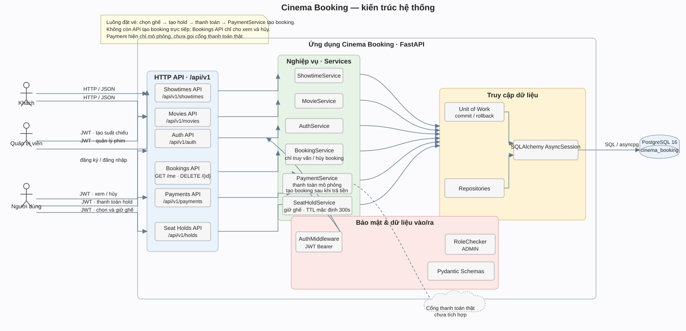
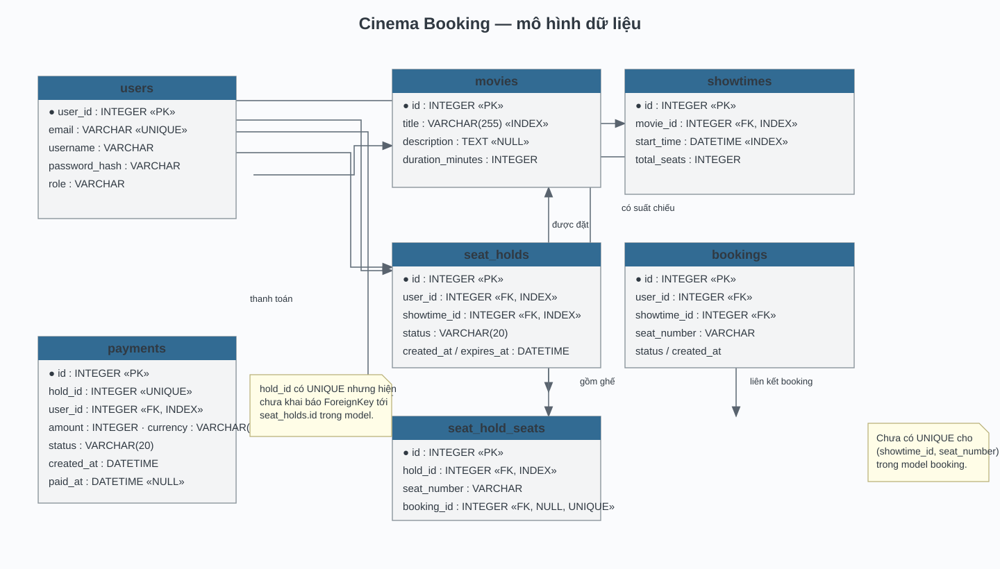
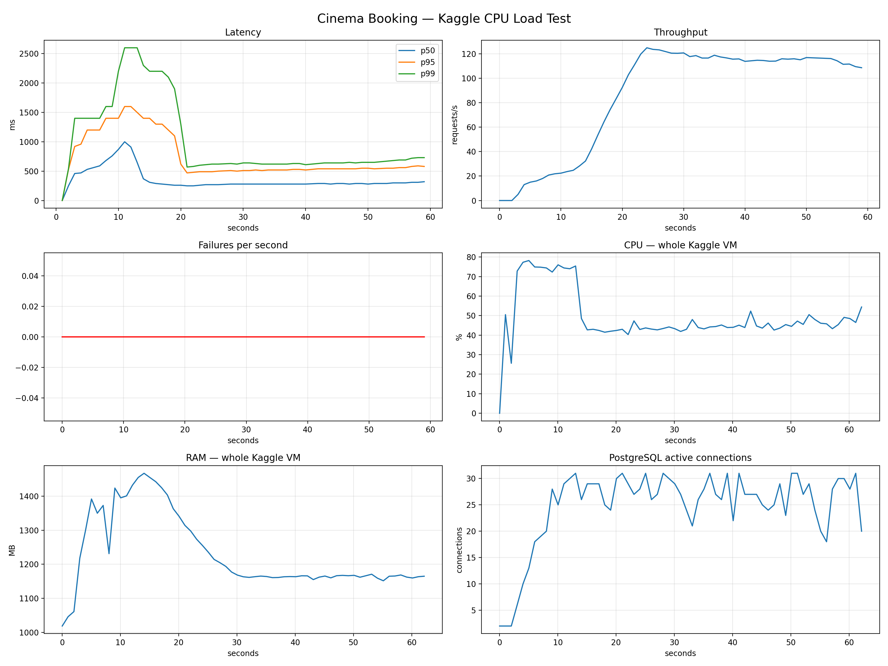

# Hệ thống đặt vé xem phim

REST API đặt vé xem phim được xây dựng bằng **Python 3.12, FastAPI và PostgreSQL 16**. Hệ thống cung cấp API tra cứu phim, suất chiếu và ghế; đăng ký, đăng nhập bằng JWT; giữ ghế tạm thời; thanh toán mô phỏng và quản lý booking.

## 1. Bài toán và phạm vi

Người dùng có thể tra cứu phim, suất chiếu và tình trạng ghế. Sau khi đăng nhập, họ có thể giữ ghế trong thời gian giới hạn, thanh toán mô phỏng để tạo booking, xem booking và hủy booking.

- **Khách chưa đăng nhập:** xem phim, suất chiếu, tình trạng ghế; đăng ký hoặc đăng nhập.
- **`USER`:** giữ, xem và giải phóng ghế; thanh toán hold; xem và hủy booking của mình.
- **`ADMIN`:** tạo, cập nhật và xóa phim; tạo suất chiếu.

Hold mặc định có hiệu lực 300 giây (`SEAT_HOLD_TTL_SECONDS`). Giá mỗi ghế trong thanh toán demo được cấu hình bằng `DEMO_PAYMENT_AMOUNT_VND`. Booking chỉ được tạo sau khi thanh toán cho hold thành công.

## 2. Kiến trúc và thiết kế hệ thống

### Kiến trúc hệ thống

Hệ thống được tổ chức theo kiến trúc phân lớp **Layered Architecture** gồm **API Router, Application Service, Domain và Repository**, sử dụng PostgreSQL để lưu trữ dữ liệu. Request đi qua **AuthMiddleware** để xác thực JWT, sau đó Router kiểm tra dữ liệu và quyền truy cập trước khi gọi Service. Service xử lý nghiệp vụ, còn Repository truy xuất dữ liệu và **Unit of Work** quản lý transaction. 

Luồng đặt vé gồm: chọn suất và ghế → giữ ghế tạm thời → thanh toán mô phỏng → tạo booking và lưu payment.



Mã nguồn sơ đồ thành phần và sequence luồng giữ ghế/thanh toán: [architecture.puml](docs/diagrams/architecture.puml).

### Thiết kế cơ sở dữ liệu

Cơ sở dữ liệu gồm các bảng `users`, `movies`, `showtimes`, `bookings`, `seat_holds`, `seat_hold_seats` và `payments`. `payments.hold_id` có ràng buộc duy nhất nhưng chưa phải khóa ngoại. 
Bảng `bookings` chưa có ràng buộc duy nhất cho một ghế trong một suất chiếu; các service hiện tại tuần tự hóa thao tác liên quan bằng khóa bản ghi suất chiếu.



Mã nguồn sơ đồ: [database.puml](docs/diagrams/database.puml).

## 3. API và bảo mật

API sử dụng REST và JSON. Khi ứng dụng chạy, tài liệu tương tác có tại [Swagger UI](http://localhost:8000/docs); đặc tả API nằm trong [api-reference.md](docs/api-reference.md).

| Nhóm endpoint | Quyền | Chức năng |
| --- | --- | --- |
| `/api/v1/auth` | Công khai / người dùng | Đăng ký, đăng nhập, xem tài khoản hiện tại |
| `/api/v1/movies` | Công khai xem / `ADMIN` ghi | Tra cứu, tạo, cập nhật và xóa phim |
| `/api/v1/showtimes` | Công khai xem / `ADMIN` tạo | Tra cứu, lọc và tạo suất chiếu |
| `/api/v1/showtimes/{showtime_id}/seats` | Công khai | Xem tình trạng ghế của suất chiếu |
| `/api/v1/holds` | Người dùng đã đăng nhập | Tạo, xem và giải phóng hold |
| `/api/v1/payments` | Người dùng đã đăng nhập | Thanh toán hold và xem lịch sử thanh toán |
| `/api/v1/bookings` | Chủ booking | Xem và hủy booking của mình |

Mật khẩu được băm trước khi lưu. Các route cần xác thực dùng Bearer JWT. Service kiểm tra quyền sở hữu hold, payment và booking theo người dùng hiện tại. Booking được tạo trong luồng thanh toán hold.

## 4. Kiến trúc và tổ chức mã nguồn

Request đi từ API qua service và repository tới PostgreSQL. Các thư mục chính:

```text
app/
  api/             # HTTP routers, dependencies và providers
  core/            # Cấu hình, bảo mật, middleware và xử lý lỗi
  db/              # Kết nối PostgreSQL và SQLAlchemy base
  domain/          # Entity, command, result, port và Unit of Work contract
  models/          # SQLAlchemy models cho database
  repositories/    # Truy vấn database và ánh xạ ORM/entity
  schemas/         # Kiểm tra request và định dạng response
  services/        # Nghiệp vụ ứng dụng
scripts/           # Khởi tạo database và tiện ích kiểm thử
tests/             # Unit và integration tests
load_test/         # Kịch bản Locust
data/              # Dữ liệu mẫu
docs/              # Tài liệu API, cài đặt và sơ đồ
```

Công nghệ chính: **FastAPI, SQLAlchemy async, PostgreSQL, Pydantic, JWT, Docker Compose và Locust**.


## 5. Cài đặt và chạy

Hướng dẫn chạy bằng Docker hoặc Python, nạp dữ liệu mẫu và các lưu ý khi dùng database hiện hữu nằm trong [setup.md](docs/setup.md). 

## 6. Demo Phase 1

1. Mở Swagger UI để xem phim, suất chiếu và tình trạng ghế.
2. Đăng ký hoặc đăng nhập để nhận JWT.
3. Gửi token để tạo hold cho các ghế còn trống.
4. Thanh toán mô phỏng cho hold; booking được tạo khi payment thành công.
5. Xem hoặc hủy booking; tài khoản ADMIN có thể quản lý phim và tạo suất chiếu.

## 7. Số liệu kiểm thử tải đã ghi nhận

Các số liệu dưới đây là kết quả đo cũ, trước khi luồng giữ ghế → thanh toán → booking được chuẩn hóa. Kịch bản `load_test/load_test.py` hiện dùng API đăng ký, xem suất/ghế, giữ và giải phóng ghế, thanh toán hold, rồi xem booking/payment. Cần chạy lại kịch bản để có số liệu đánh giá luồng hiện tại. Lần đo cũ chạy API, PostgreSQL và Locust cùng máy Kaggle, dùng 50 người dùng ảo, tăng 5 người mỗi giây trong 60 giây.

| Chỉ số | Kết quả |
| --- | ---: |
| Tổng request | 5.908 |
| Request lỗi | 0 (0%) |
| Thông lượng trung bình | 99,39 request/giây |
| Độ trễ trung bình | 346,75 ms |
| p50 / p95 / p99 | 290 / 650 / 1.200 ms |
| CPU trung bình / cao nhất | 49,2% / 78,2% |
| RAM trung bình / cao nhất | 1.231 / 1.467 MB |



## 8. Giới hạn hiện tại

- Thanh toán chỉ mô phỏng; chưa tích hợp cổng thanh toán, webhook hoặc hoàn tiền.
- Chưa có giao diện đặt vé hoàn chỉnh, sơ đồ ghế, email thông báo hoặc worker nền.
- Các thao tác hold, thanh toán và giải phóng khóa bản ghi suất chiếu, nên thao tác trên cùng suất được tuần tự hóa đến khi transaction kết thúc. Database chưa có partial unique index làm lớp bảo vệ cuối cho booking đang hoạt động.
- Hold hết hạn được xác định khi API đọc hoặc cập nhật dữ liệu; chưa có tác vụ nền tự xử lý.
- Khởi tạo database dùng `create_all`, chỉ tạo bảng còn thiếu và không thay thế migration cho schema đã tồn tại.

## 9. Các gợi ý cải tiến cho Pha 2

Hệ thống hiện đã có các cơ chế nền tảng cho giữ ghế, thanh toán, truy vấn và quản lý transaction. Khi cần xử lý tải lớn hoặc quy trình thực tế phức tạp hơn, Pha 2 các nhóm có thể tham khảo nâng cấp theo các hướng sau:

|  | Cơ chế hiện tại | Gợi ý cải tiến Pha 2 | Mục tiêu |
| --- | --- | --- | --- |
| 1 | Các thao tác giữ, thanh toán và giải phóng ghế khóa dòng suất chiếu. | Chuyển sang quản lý tồn kho theo từng ghế hoặc khóa theo ghế; kết hợp ràng buộc duy nhất có điều kiện cho booking đang hoạt động. | Giảm tranh chấp giữa khách chọn ghế khác nhau và duy trì tính nhất quán khi nhiều request đồng thời. |
| 2 | Thanh toán gửi lại cho cùng một hold có thể trả về kết quả đã tạo. | Mở rộng idempotency key cho toàn bộ thao tác tạo hold và thanh toán, lưu trạng thái yêu cầu với ràng buộc duy nhất. | Chịu được retry do timeout hoặc mất kết nối mà không tạo giao dịch lặp. |
| 3 | Payment mô phỏng, booking và hold được ghi trong một transaction database. | Khi tích hợp cổng thanh toán, dùng transactional outbox kết hợp Saga/state machine, webhook đã xác thực và quy trình đối soát. | Xử lý nhất quán các bước giao dịch nằm giữa database và dịch vụ thanh toán bên ngoài. |
| 4 | Thời hạn hold được kiểm tra trong các luồng đọc và ghi. | Dùng hàng đợi tác vụ có lịch chạy hoặc worker, kèm cập nhật trạng thái có điều kiện để phối hợp an toàn với thanh toán và giải phóng hold. | Xử lý lượng lớn hold hết hạn mà không phụ thuộc vào request của khách và tránh chuyển trạng thái sai khi có cạnh tranh. |
| 5 | Các request đọc lấy dữ liệu từ PostgreSQL. | Bổ sung cache-aside có TTL và cơ chế invalidation theo phiên bản hoặc sự kiện cho dữ liệu ít thay đổi như phim và suất chiếu. | Giảm tải đọc database mà vẫn kiểm soát độ mới của dữ liệu. |
| 6 | Repository truy vấn danh sách và dữ liệu nghiệp vụ trực tiếp. | Dùng cursor pagination, phân tích `EXPLAIN ANALYZE` và thiết kế index theo truy vấn thực tế. | Giữ truy vấn ổn định khi bảng lớn, tránh tải toàn bộ danh sách và giảm thời gian phản hồi. |
| 7 | Một API process dùng pool kết nối database với giới hạn cấu hình cố định. | Tính ngân sách connection theo số worker/replica; cân nhắc read replica cho truy vấn phù hợp và giữ các luồng cần đọc sau ghi trên primary. | Mở rộng số instance mà không làm cạn connection PostgreSQL hoặc trả dữ liệu chưa cập nhật. |
| 8 | API xử lý trực tiếp các request nghiệp vụ đồng bộ. | Áp dụng rate limiting, giới hạn tải và hàng đợi cho tác vụ có thể xử lý bất đồng bộ. | Điều tiết đột biến request và bảo vệ database, dịch vụ thanh toán khỏi quá tải. |
| 9 | Kiểm tra tải qua các kịch bản Locust hiện có. | Xây dựng workload theo hành vi thực tế, tăng dần tải và đo p95/p99, lock wait, pool saturation cùng tỷ lệ giao dịch thành công. | Xác định ngưỡng chịu tải và điểm nghẽn trước khi tăng tài nguyên hoặc thay đổi kiến trúc. |
| 10 | Theo dõi ứng dụng chủ yếu qua log và trạng thái endpoint. | Bổ sung structured logging, metrics, distributed tracing, dashboard và cảnh báo theo SLO. | Theo dấu một lượt đặt vé xuyên suốt API, database và cổng thanh toán, rút ngắn thời gian phát hiện sự cố. |
