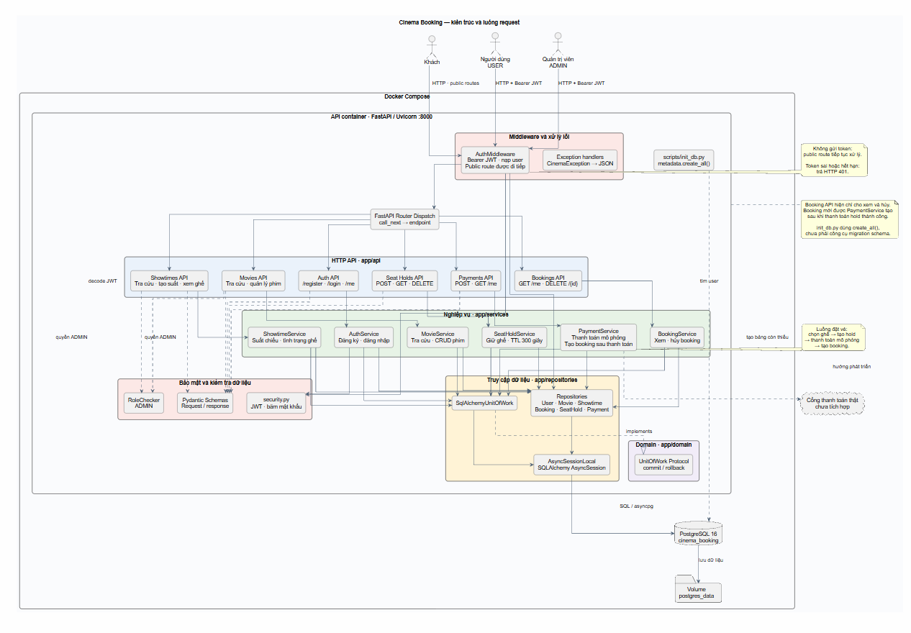

# Hệ thống đặt vé xem phim

REST API đặt vé xem phim, xây dựng bằng **Python 3.12, FastAPI và PostgreSQL 16**. Hệ thống hỗ trợ tra cứu phim, suất chiếu và ghế; đăng ký, đăng nhập bằng JWT; đặt ghế, giữ ghế tạm thời và thanh toán mô phỏng.

## 1. Bài toán và phạm vi

Khách có thể tìm phim, chọn suất chiếu và kiểm tra ghế trước khi đặt. Người dùng đã đăng nhập có thể đặt ghế trực tiếp hoặc giữ ghế trong thời gian giới hạn trước khi thanh toán.

- **Khách chưa đăng nhập:** xem phim, suất chiếu và tình trạng ghế; đăng ký hoặc đăng nhập.
- **`USER`:** đặt, xem và hủy booking của mình; giữ hoặc giải phóng ghế; thanh toán mô phỏng.
- **`ADMIN`:** quản lý phim và tạo suất chiếu.

Hold mặc định có hiệu lực 300 giây (`SEAT_HOLD_TTL_SECONDS`). Giá thanh toán demo do backend cấu hình bằng `DEMO_PAYMENT_AMOUNT_VND`.

## 2. Kiến trúc và thiết kế hệ thống

### Kiến trúc hệ thống

Ứng dụng FastAPI chạy cùng PostgreSQL bằng Docker Compose, được tổ chức theo các lớp API, service và repository. `AuthMiddleware` kiểm tra JWT Bearer và nạp lại người dùng; `RoleChecker` giới hạn thao tác quản trị. Booking chỉ được tạo sau khi `PaymentService` xử lý payment cho hold; API booking chỉ dùng để xem và hủy. Dữ liệu được truy cập bất đồng bộ qua SQLAlchemy tới PostgreSQL. Thanh toán hiện được mô phỏng, chưa kết nối cổng bên ngoài.



Mã nguồn sơ đồ: [architecture.puml](docs/diagrams/architecture.puml).

### Thiết kế cơ sở dữ liệu

Cơ sở dữ liệu gồm người dùng, phim, suất chiếu, booking, lượt giữ ghế, các ghế trong lượt giữ và thanh toán. Quan hệ và thuộc tính trong sơ đồ phản ánh các model hiện tại; `payments.hold_id` chưa khai báo khóa ngoại và booking chưa có ràng buộc duy nhất cho một ghế trong một suất chiếu.


Mã nguồn sơ đồ: [database.puml](docs/diagrams/database.puml).

## 3. API và bảo mật

API dùng REST và JSON. Khi ứng dụng đang chạy, tài liệu tương tác có tại [Swagger UI](http://localhost:8000/docs). 
Đặc tả api [api-reference.md](docs/api-reference.md).

| Nhóm endpoint | Quyền | Chức năng |
| --- | --- | --- |
| `/api/v1/auth` | Public / người dùng | Đăng ký, đăng nhập, xem tài khoản |
| `/api/v1/movies` | Public xem / `ADMIN` sửa | Tra cứu và quản lý phim |
| `/api/v1/showtimes` | Public xem / `ADMIN` tạo | Tra cứu, lọc và tạo suất chiếu |
| `/api/v1/showtimes/{showtime_id}/seats` | Public | Xem ghế còn trống |
| `/api/v1/bookings` | Người dùng | Xem và hủy booking của mình; booking chỉ được tạo sau payment |
| `/api/v1/holds` | Người dùng | Giữ, xem và giải phóng ghế |
| `/api/v1/payments` | Người dùng | Thanh toán mô phỏng và xem lịch sử |

Mật khẩu được băm trước khi lưu. API dùng Bearer JWT; booking, hold và payment chỉ được truy cập bởi chủ sở hữu.

## 4. Kiến trúc và tổ chức mã nguồn

Request đi từ API qua service và repository tới PostgreSQL. Các thư mục chính:

```text
app/
  api/             # Nhận các yêu cầu HTTP
  core/            # Cấu hình, đăng nhập và xử lý lỗi
  db/              # Kết nối PostgreSQL
  domain/          # Vai trò và giao diện nghiệp vụ
  models/          # Cấu trúc dữ liệu trong database
  repositories/    # Đọc và ghi dữ liệu
  schemas/         # Kiểm tra dữ liệu vào và ra
  services/        # Xử lý nghiệp vụ
scripts/           # Khởi tạo database
tests/            # Unit và integration tests
load_test/         # Kịch bản Locust
data/             # Dữ liệu mẫu
```

Công nghệ chính: **FastAPI, SQLAlchemy async, PostgreSQL, Pydantic, JWT, Docker Compose và Locust**.

### Độc lập tầng nghiệp vụ

Service nhận command Python thuần trong `app/domain/commands.py`, làm việc với entity bất biến trong `app/domain/entities.py` và các port trong `app/domain/ports.py`. Repository chuyển ORM thành entity trước khi trả kết quả; cập nhật dữ liệu bằng ID thay vì sửa entity. UnitOfWork tiếp tục có một hợp đồng duy nhất trong `app/domain/unit_of_work.py`.

Router chuyển request Pydantic thành command; response schema giữ nguyên và chỉ xuất các trường công khai. Provider hiện tại truyền TTL giữ ghế, giá thanh toán demo và adapter hash mật khẩu/phát JWT vào service. Giữ ghế, thanh toán và giải phóng hold khóa cùng hàng suất chiếu; payment và release đọc lại hold sau khi lấy khóa. UserEntity không chứa password hash; đăng nhập đọc UserCredentials riêng. Việc gom provider và bổ sung unique index/migration thuộc các nhiệm vụ tiếp theo.

Chạy kiểm thử không cần database bằng `python -m pytest tests/unit -q`. Các test kiểm tra ranh giới import, entity/ORM mapping, ánh xạ HTTP, cấu hình được truyền vào và transaction của service; kiểm thử tích hợp PostgreSQL vẫn cần `TEST_DATABASE_URL` riêng.

## 5. Cài đặt và chạy

Cách chạy bằng Docker hoặc Python, nạp dữ liệu mẫu và chạy kiểm thử được hướng dẫn trong [setup.md](docs/setup.md).

## 6. Hướng phát triển

Có thể mở rộng hệ thống theo các bước gần với chức năng hiện có:

- Thêm giao diện để chọn phim, suất chiếu và ghế.
- Vẽ sơ đồ ghế theo hàng và cột.
- Kết nối cổng thanh toán thật và xử lý kết quả thanh toán.
- Gửi email xác nhận booking và tự giải phóng ghế hết hạn.
- Tăng an toàn khi nhiều người cùng chọn một ghế bằng ràng buộc database.

## 7. Demo Phase 1

1. Mở Swagger UI và xem phim, suất chiếu, tình trạng ghế.
2. Đăng ký hoặc đăng nhập để lấy JWT.
3. Dùng token để giữ ghế, rồi thanh toán mô phỏng; booking được tạo sau payment thành công.
4. Xem booking/payment hoặc hủy booking.
5. Đăng nhập bằng tài khoản ADMIN mẫu để tạo phim và suất chiếu.

## 8. Kết quả kiểm thử tải trên Kaggle CPU

API, PostgreSQL và Locust chạy cùng máy Kaggle. Kịch bản dùng 50 người dùng ảo, tăng 5 người mỗi giây trong 60 giây.

| Chỉ số | Kết quả |
| --- | ---: |
| Tổng request | 5.908 |
| Request lỗi | 0 (0%) |
| Thông lượng trung bình | 99,39 request/giây |
| Độ trễ trung bình | 346,75 ms |
| p50 / p95 / p99 | 290 / 650 / 1.200 ms |
| CPU trung bình / cao nhất | 49,2% / 78,2% |
| RAM trung bình / cao nhất | 1.231 / 1.467 MB |


## 9. Giới hạn hiện tại

- Thanh toán chỉ mô phỏng; chưa có cổng thanh toán, webhook hoặc hoàn tiền.
- Chưa có giao diện đặt vé hoàn chỉnh, sơ đồ ghế, email thông báo hoặc worker nền.
- Nhiều yêu cầu đồng thời có thể cùng chọn một ghế vì kiểm tra hiện chủ yếu ở tầng ứng dụng.
- Hold hết hạn được nhận biết khi API đọc/ghi dữ liệu; chưa có tác vụ nền để xử lý.

## 10. Các vấn đề có thể cải tiến trong pha 2


| # | Vấn đề | Hiện trạng | Hướng cải tiến |
| --- | --- | --- | --- |
| 1 | **Hai người có thể giữ cùng một ghế** | Ứng dụng kiểm tra ghế trước khi tạo lượt giữ. Nếu nhiều người chọn cùng lúc, ghế có thể bị giữ trùng. | Thêm quy tắc trong database để mỗi ghế chỉ được một người giữ tại một thời điểm. |
| 2 | **Thanh toán chỉ dùng để demo** | Hệ thống tự ghi nhận thanh toán thành công. | Kết nối cổng thanh toán và cập nhật booking theo kết quả thanh toán. |
| 3 | **Ghế hết hạn chưa được tự giải phóng** | Hệ thống chỉ nhận ra lượt giữ hết hạn khi có yêu cầu đọc hoặc cập nhật dữ liệu. | Thêm tác vụ chạy định kỳ để cập nhật lượt giữ hết hạn và giải phóng ghế. |
| 4 | **Gửi lại yêu cầu có thể tạo lượt giữ mới** | Nếu mất kết nối, ứng dụng phía người dùng có thể gửi lại yêu cầu và tạo thêm lượt giữ. Việc gửi lại thanh toán cho cùng hold đã được hỗ trợ. | Gắn mã riêng cho mỗi yêu cầu giữ ghế để gửi lại mà không tạo lượt giữ mới. |
| 5 | **Database phải đọc lại dữ liệu nhiều lần** | Phim, suất chiếu và người dùng được đọc trực tiếp từ database mỗi lần cần. | Lưu tạm dữ liệu ít thay đổi để giảm số lần đọc và tăng tốc độ phản hồi. |
| 6 | **Danh sách chưa chia trang** | API trả về toàn bộ phim, suất chiếu, booking hoặc payment cùng lúc. | Cho phép tải từng trang để danh sách lớn dễ xem và tải nhanh hơn. |
| 7 | **Chưa làm mới hoặc thu hồi token** | Token có thời hạn nhưng chưa có chức năng làm mới hoặc đăng xuất để vô hiệu hóa token. | Thêm chức năng làm mới token và đăng xuất khỏi tài khoản. |
| 8 | **Số kết nối database đang đặt cố định** | Mỗi tiến trình API có thể mở tối đa 30 kết nối. | Điều chỉnh số kết nối theo số tiến trình API và khả năng của database. |
