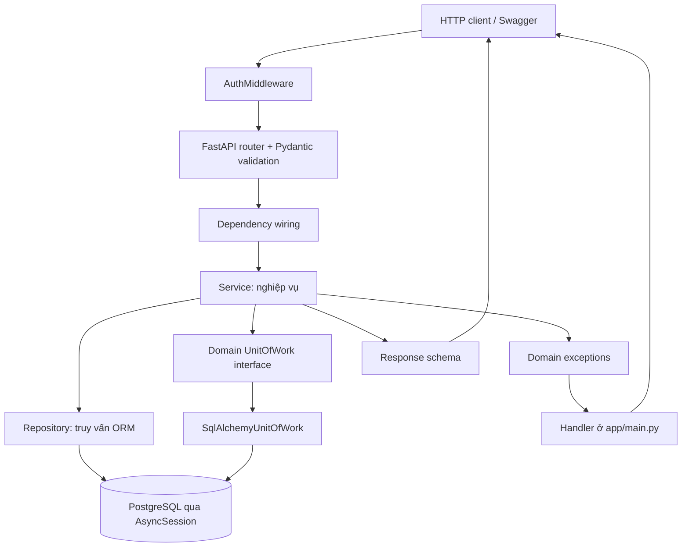
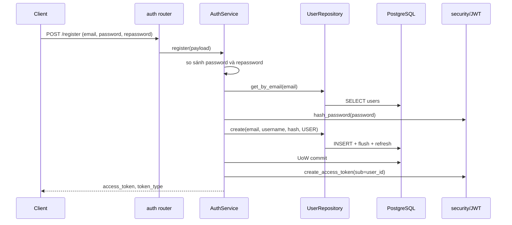
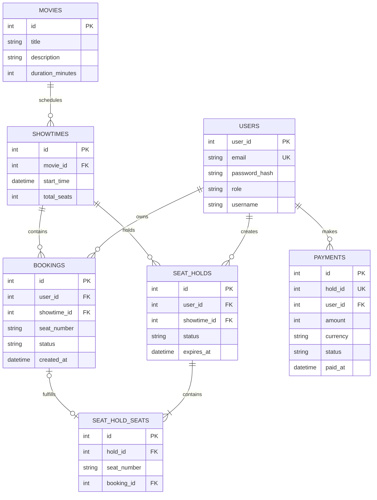

# Cinema Booking: hướng dẫn đọc mã nguồn và thuyết trình đồ án

> Tài liệu giới thiệu kiến trúc, các luồng nghiệp vụ, mô hình dữ liệu, API và những giới hạn cần nắm khi trình bày dự án. Các nhãn **ĐÃ TRIỂN KHAI**, **CÓ MÃ KIỂM THỬ**, **ĐÃ KIỂM THỬ**, **SUY LUẬN** và **RỦI RO/CÒN THIẾU** phân biệt chức năng trong mã nguồn, kiểm thử có trong kho mã, kết quả đã chạy, nhận định suy luận và vấn đề cần xử lý. Khi cần xác nhận hành vi cụ thể, đối chiếu mã nguồn và OpenAPI.

## Phạm vi và cách dùng

Tài liệu tập trung vào cách các thành phần phối hợp và lý do thiết kế. Đường dẫn mã nguồn được ghi cạnh nội dung liên quan để tiện tra cứu; số dòng có thể thay đổi khi mã nguồn được chỉnh sửa.

## Chương 1 — Bản đồ hệ thống

### Cách đọc sơ đồ

Ứng dụng là REST API FastAPI, không phải website có giao diện đặt vé hoàn chỉnh. Client gửi JSON qua HTTP; `app/main.py` khởi tạo app, middleware xử lý bearer token, rồi router nhận request và ghép schema/dependency. Service thực thi quy tắc nghiệp vụ; repository truy vấn ORM; `AsyncSession` kết nối PostgreSQL. `UnitOfWork` hiện chỉ bọc `commit` và `rollback`, không phải lớp điều phối repository độc lập.

Luồng không hoàn toàn “clean architecture”: service còn phụ thuộc ORM model và schema Pydantic; router còn chịu trách nhiệm dựng dependency. Sáu router được include là auth, movie, showtime, booking, payment và seat hold. Không có router/adapter cho cổng thanh toán thật, chọn ghế theo sơ đồ phòng, gửi email hay worker nền hết hạn hold.

Request không có bearer có thể đến endpoint public. Nếu client gửi bearer sai hoặc hết hạn, middleware chặn request trước route, kể cả route public. Endpoint cần đăng nhập yêu cầu identity; quyền ADMIN và quyền sở hữu được kiểm tra riêng ở tầng route/service.

### Bài toán và vai trò

Ứng dụng cung cấp REST API để xem phim, suất chiếu, trạng thái ghế; đăng ký/đăng nhập; đặt ghế trực tiếp hoặc giữ một nhóm ghế rồi thanh toán demo; xem/hủy booking cá nhân. ADMIN được phép ghi phim và tạo suất chiếu. Mã hiện tại không kết nối cổng thanh toán thật.

- **Khách chưa đăng nhập:** đọc danh sách/chi tiết phim, showtime và trạng thái ghế; đăng ký/đăng nhập.
- **USER:** thao tác booking, hold, payment thuộc tài khoản hiện tại.
- **ADMIN:** quyền USER cộng với tạo/sửa/xóa phim và tạo showtime. Role đọc từ bản ghi User trong database.

Đăng ký gán role `USER` trong `AuthService.register` (`app/services/auth_service.py:21-44`). `Role.ADMIN`/`Role.USER` là enum thuần (`app/domain/roles.py:1-7`). Không có endpoint cấp quyền admin trong routers được đăng ký.

### Stack thực tế

Python async, FastAPI, Pydantic, SQLAlchemy async, PostgreSQL/asyncpg, PyJWT, pwdlib, Docker Compose. Căn cứ: manifest `requirements.txt`, imports trong `app/main.py`, `app/db/database.py:1-25`, `app/core/security.py:1-14` và `docker-compose.yml`. Phiên bản package phải đọc từ manifest tại thời điểm chạy; tài liệu này không suy diễn số phiên bản ngoài nội dung đó.

### Kiến trúc code thực tế



Đây là phân tầng mục tiêu thể hiện qua cách nối dependency; implementation không hoàn toàn tách domain: một số service import ORM model/Pydantic schema trực tiếp. Routers tạo repository và `SqlAlchemyUnitOfWork` từ cùng session, ví dụ `app/api/booking.py:28-38`, `app/api/payment.py:16-23`; transaction của payment/booking/hold vì vậy dùng cùng session. `AuthMiddleware` mở session riêng để tìm user trước khi vào dependency của endpoint (`app/core/auth_middleware.py:14-38`).

### Vòng đời request

1. ASGI/FastAPI nhận request; `AuthMiddleware` kiểm tra header Authorization nếu có.
2. FastAPI chọn route, parse path/query/body và validate bằng Pydantic. Lỗi validation mặc định của FastAPI thường là 422.
3. `Depends` dựng service cùng repository và session; endpoint gọi service.
4. Service áp dụng quy tắc nghiệp vụ; repository thực hiện SQLAlchemy query/flush.
5. Với ghi dữ liệu, service gọi Unit of Work để commit; nếu lỗi trong khối ghi thì gọi rollback.
6. FastAPI serialize kết quả qua `response_model`; lỗi domain đi qua handler toàn cục thành `{"detail":"..."}`.

Handler và mapping exception nằm ở `app/main.py:38-68`; các router và thứ tự đăng ký ở `app/main.py:72-77`.

## Chương 2 — Cây thư mục và vai trò từng file

```text
.
├── app/
│   ├── main.py                   tạo FastAPI, middleware, exception handler, include routers
│   ├── api/                      HTTP routes và dependency wiring
│   ├── core/                     config, JWT/hash, middleware, permission, exceptions
│   ├── db/database.py            Base, engine, async session, get_db
│   ├── domain/                   Role và Protocol UnitOfWork
│   ├── models/                   ORM tables
│   ├── repositories/             truy vấn/persistence và UoW SQLAlchemy
│   ├── schemas/                  Pydantic request/response
│   └── services/                 quy tắc nghiệp vụ
├── scripts/init_db.py            tạo bảng còn thiếu bằng metadata.create_all
├── seed.py                       nạp/sync phim và showtime mẫu
├── data/movie.json               nguồn dữ liệu phim mẫu cho seeder
├── tests/                        integration tests PostgreSQL và unit tests
└── load_test/load_test.py        kịch bản Locust
```

### Entry point, core và database

| File | Trách nhiệm và điểm cần biết |
|---|---|
| `app/main.py:30-77` | Entry point duy nhất: tạo `FastAPI`, gắn middleware, ánh xạ domain exceptions, đăng ký sáu router. |
| `app/core/config.py:5-15` | Settings đọc `.env`; bắt buộc `DATABASE_URL`, `SECRET_KEY`; mặc định algorithm HS256, token 60 phút, SQL echo false, payment 100000 VND/ghế, hold 300 giây. |
| `app/core/security.py:10-38` | Hash/verify password; phát và decode JWT. |
| `app/core/auth_middleware.py:11-46` | Parse Bearer, decode `sub`, nạp User vào request state hoặc trả 401. |
| `app/core/permission.py:7-28` | `RoleChecker`: xác thực object User trên request state và so role. |
| `app/core/exceptions.py:15-137` | Domain exception thuần Python; các lớp ownership/state/not-found/duplicate. |
| `app/db/database.py:8-37` | Declarative Base, engine với pool size 10/max overflow 20, session factory và dependency `get_db`. |
| `app/domain/__init__.py:1` | Ghi nhận package domain chứa các khái niệm nghiệp vụ không phụ thuộc framework. |
| `app/domain/roles.py:1-7` | Enum role, không phụ thuộc ORM. |
| `app/domain/unit_of_work.py:1-12` | Protocol chỉ khai báo commit/rollback. |
| `app/repositories/unit_of_work.py:1-14` | Adapter commit/rollback trên AsyncSession. |

### API, schema, service, repository và model theo module

Mỗi hàng liệt kê tất cả file ứng dụng trong module. Hàm quan trọng/luồng cụ thể được phân tích ở Chương 5–12.

| Module/file | Mục đích và liên kết |
|---|---|
| `app/api/auth.py:11-39` | `/auth`; lắp `AuthService`, route register/login/me. |
| `app/api/dependencies.py:5-29` | Lấy User từ request state; tạo `UserIdentity` hoặc public account dict. |
| `app/schemas/auth.py:1-23` | Đăng ký/đăng nhập, phản hồi token và thông tin người dùng hiện tại. |
| `app/services/auth_service.py:12-52` | So khớp password xác nhận, tạo user, login và phát token. |
| `app/repositories/user_repository.py:7-25` | Tìm user theo id/email và insert user. |
| `app/models/user.py:8-15` | Bảng `users`; email unique; password lưu hash. |
| `app/api/movie.py:12-63` | Đọc công khai và ghi phim dành cho ADMIN. |
| `app/schemas/movie.py:5-24` | Ràng buộc tiêu đề/thời lượng và cấu trúc phản hồi. |
| `app/services/movie_service.py:7-60` | Read, create/update/delete; commit/rollback ghi. |
| `app/repositories/movie_repository.py:8-48` | CRUD ORM; list theo id giảm dần. |
| `app/models/movie.py:6-13` | Bảng movies. |
| `app/api/showtime.py:15-57` | Liệt kê suất chiếu/ghế công khai; tạo suất chiếu dành cho ADMIN. |
| `app/schemas/showtime.py:7-24` | Dữ liệu vào và phản hồi cho suất chiếu, ghế. |
| `app/services/showtime_service.py:9-59` | Xác nhận movie, dựng availability từ booking+hold. |
| `app/repositories/showtime_repository.py:8-29` | List/filter, get, create showtime. |
| `app/models/showtime.py:9-18` | Bảng showtimes; `start_time` là `DateTime` không bật timezone. |
| `app/api/booking.py:21-83` | Route đặt trực tiếp, list cá nhân, hủy. |
| `app/schemas/booking.py:6-19` | Request và response booking. |
| `app/services/booking_service.py:18-182` | Capacity/duplicate/ownership/state rules. |
| `app/repositories/booking_repository.py:11-110` | CRUD, seat lookup, multi-booking insert; không tự commit. |
| `app/models/booking.py:9-21` | Bảng booking; trạng thái mặc định `active`; không khai báo duy nhất theo ghế/suất chiếu. |
| `app/api/seat_hold.py:14-51` | Tạo/xem/giải phóng hold; toàn bộ cần identity. |
| `app/schemas/seat_hold.py:7-30` | Giữ tạm 1–5 ghế; kiểm tra nhãn số dương và không trùng trong yêu cầu. |
| `app/services/seat_hold_service.py:14-126` | Tạo hold, quyền sở hữu, release/expiry và sinh ID ngẫu nhiên. |
| `app/repositories/seat_hold_repository.py:9-70` | Lưu lượt giữ và ghế; lọc ghế đang được giữ và chưa hết hạn. |
| `app/models/seat_hold.py:9-40` | Hai bảng `seat_holds`, `seat_hold_seats`; booking_id unique nullable cho liên kết sau payment. |
| `app/api/payment.py:13-50` | Pay hold và list payments của tôi. |
| `app/schemas/payment.py:8-26` | Dữ liệu vào/ra thanh toán và kết quả gồm thanh toán cùng các booking. |
| `app/services/payment_service.py:15-100` | Thanh toán mô phỏng, tạo booking, liên kết lượt giữ và xử lý yêu cầu gửi lại an toàn khi lượt giữ đã thanh toán. |
| `app/repositories/payment_repository.py:9-48` | Tạo thanh toán thành công, tìm theo lượt giữ và liệt kê theo người dùng. |
| `app/models/payment.py:9-26` | Bảng payments; unique `hold_id`; amount/currency/status/timestamps. |

Không thấy migration tool trong inventory file; `scripts/init_db.py:16-33` gọi `Base.metadata.create_all`, chỉ tạo bảng thiếu, không nâng cấp schema đang tồn tại. Đây là **IMPLEMENTED** theo script, không giả định schema production đồng bộ.

## Chương 3 — Khái niệm nền để đọc code

| Khái niệm | Giải thích trong dự án |
|---|---|
| HTTP method/path | Method biểu thị thao tác; path chọn route, ví dụ `POST /api/v1/bookings/`. |
| JSON/body/header | Body mang payload; header Authorization mang Bearer JWT. |
| Status code | 2xx thành công, 4xx lỗi client; app tự ánh xạ domain errors, FastAPI xử lý validation. |
| Function/class/type hints | Function là hành động; class gom state/hành vi; hint như `AsyncSession` hỗ trợ đọc/kiểm tra, không tự xác thực runtime mọi giá trị. |
| `async`/`await` | Coroutine nhường event loop khi chờ I/O; `await` không biến SQL đồng bộ thành async. App dùng async driver/repositories nhưng test fixtures có adapter đồng bộ. |
| Decorator | `@router.get(...)` đăng ký hàm làm endpoint và khai báo metadata/response model. |
| Dependency injection | `Depends(get_db)`/`Depends(get_booking_service)` cho FastAPI tạo và truyền dependency. Giúp tái sử dụng và override trong test. |
| Pydantic schema | Ranh giới dữ liệu HTTP: validate input, định hình response. Khác ORM model là biểu diễn bảng database. |
| ORM / SQLAlchemy | `Mapped`/`mapped_column` khai báo cột; repository dùng `select`, `session.get`, `add`, `flush`. |
| Session | Đại diện đơn vị làm việc/identity map; session không đồng nghĩa một câu SQL hay một transaction đã commit. |
| `flush` | Gửi pending changes trong transaction để DB cấp ID/kiểm tra constraint; chưa commit, nên rollback vẫn có thể hủy. |
| `commit`/`rollback` | Commit chốt transaction; rollback hủy thay đổi chưa commit. UoW adapter gọi trực tiếp hai API này. |
| Repository | Đóng gói query và persistence; hiện repository dùng ORM model, session được truyền từ router dependency. |
| Unit of Work | Giao diện ranh giới transaction; ở đây chỉ có `commit`/`rollback`, implementation SQLAlchemy giữ cùng session. |
| Middleware | Bao quanh request trước endpoint; middleware auth nạp User vào `request.state`. |
| Authentication/authorization | Authentication xác nhận danh tính; authorization kiểm tra quyền role hoặc quyền sở hữu resource. JWT hợp lệ không tự đồng nghĩa quyền ADMIN. |
| JWT | Token ký chứa `sub` user id và `exp`; không mã hóa kín dữ liệu payload. Role hiện được lấy lại từ DB theo User. |
| Password hashing | Hash một chiều chậm dùng để lưu/verify; code không lưu password thuần trong model. |
| Fixture/mock | Fixture chuẩn bị môi trường/dữ liệu; mock/fake thay dependency để unit test không cần DB thật. |

### Ba phân biệt dễ nhầm khi trình bày

- **Validate khác quy tắc nghiệp vụ:** Pydantic có thể từ chối seat label sai định dạng với 422; ghế có đang bị booking/hold chiếm hay không do service truy vấn dữ liệu.
- **Flush khác commit:** `flush()` gửi SQL trong transaction và thường cấp ID, nhưng dữ liệu chưa được chốt. Commit thành công mới kết thúc transaction; rollback không thể đảo ngược commit đã hoàn tất.
- **Async khác chạy song song:** `async/await` giúp event loop xử lý việc khác khi chờ I/O. Nó không tự serialize hai yêu cầu đặt cùng ghế và không bảo đảm invariant dữ liệu.

Response schema cũng không phải bản sao của ORM model: endpoint khai báo `response_model` để định hình payload công khai. Không nên suy luận mọi cột DB đều được trả cho client.

## Chương 4 — Tính năng và trạng thái bằng chứng

Các nhãn phân biệt chức năng có trong source, test có trong repository và kết quả test đã chạy. Việc có file test không tự chứng minh rằng test đã chạy thành công hoặc xác nhận hành vi trên PostgreSQL thật.

| Tính năng | Mã nguồn | Kiểm thử trong kho mã | Giới hạn |
|---|---|---|---|
| Đăng ký/đăng nhập/JWT | **ĐÃ TRIỂN KHAI** `auth_service.py`, `security.py` | Có unit test và integration test xác thực tại `tests/unit/test_auth.py` và `tests/test_auth.py`. | Chưa thấy quy định độ dài/độ phức tạp mật khẩu hoặc refresh token. |
| Đọc phim/suất chiếu công khai | **ĐÃ TRIỂN KHAI** router/service/repository | Có các tệp unit test và integration test tương ứng. | Chưa có phân trang/tìm kiếm nâng cao. |
| ADMIN ghi phim/tạo suất chiếu | **ĐÃ TRIỂN KHAI** `RoleChecker(Role.ADMIN)` trong router | Có kiểm thử quyền ADMIN ở xác thực/phim/suất chiếu. | Xóa phim đang được tham chiếu có thể bị khóa ngoại từ chối; chưa thấy ánh xạ lỗi riêng. |
| Đặt trực tiếp một ghế | **ĐÃ TRIỂN KHAI** | Có unit test và integration test booking. | Kiểm tra trùng theo kiểu kiểm tra rồi mới ghi, không có ràng buộc database bảo đảm tính nguyên tử. |
| Giữ nhiều ghế | **ĐÃ TRIỂN KHAI** | Danh sách tệp chưa có kiểm thử riêng cho service/router giữ ghế. | Chưa có khóa database ngăn tranh chấp giữa giữ ghế/booking/thanh toán. |
| Thanh toán mô phỏng | **ĐÃ TRIỂN KHAI** | Danh sách tệp kiểm thử chưa có bài kiểm thử thanh toán riêng. | Không kết nối cổng thanh toán thật; trạng thái payment hiện được ghi là `succeeded`. |
| Kiểm thử tải | Kịch bản `load_test/load_test.py` | Tạo booking trực tiếp. | Không đo luồng giữ ghế/thanh toán và không thay thế kiểm thử tải trong môi trường triển khai. |

Không có test hiện hành xác nhận constraint database ngăn hai request đặt cùng ghế; model `Booking` cũng không khai báo constraint này. Các test booking thông thường không chứng minh được hành vi đồng thời.

## Chương 5 — Truy vết các luồng end-to-end

### A. Đăng ký và đăng nhập



Evidence: router/service wiring `app/api/auth.py:11-39`; validation/business and commit `app/services/auth_service.py:21-52`; repository insert `app/repositories/user_repository.py:13-25`; hashing/JWT `app/core/security.py:16-38`.

Thứ tự đáng hiểu: mật khẩu confirmation được so sánh trước query; email query kiểm tra trùng ở service; role được đặt cố định `USER`; create repository flush/refresh; service commit; chỉ sau commit phát JWT. Email unique ở DB bảo vệ trùng cuối cùng, nhưng cạnh tranh đăng ký có thể vượt qua precheck và tạo lỗi DB chưa được ánh xạ thành `EmailAlreadyExistsError`.

### B. Request có Bearer và authorization

1. Middleware đặt `request.state.current_user = None`.
2. Không có Authorization: request tiếp tục; route public có thể chạy, route cần identity sẽ bị 401.
3. Có Authorization: phải parse thành Bearer + token không rỗng; token sai chặn request với 401, kể cả route public.
4. `decode_access_token` verify JWT qua PyJWT, lấy claim `sub`, cast sang int.
5. Middleware mở `AsyncSessionLocal`, truy vấn User theo ID; user không còn trong DB => 401.
6. Gắn ORM User vào request state; dependency `get_current_user` trả `{id, role}` kiểu `UserIdentity`; `get_current_user_account` trả `user_id/email/role`.
7. Các route admin thêm `RoleChecker(Role.ADMIN)`, còn booking/hold/payment gọi dependency identity. Việc sở hữu tài nguyên được service kiểm tra riêng.

Evidence: `app/core/auth_middleware.py:14-46`, `app/core/security.py:24-38`, `app/api/dependencies.py:10-29`, `app/core/permission.py:13-28`, các router tương ứng.

Nuance: middleware mở session truy vấn user riêng, rồi dependency DB của route dựng session khác. Vì middleware đóng session trước `call_next`, ORM User trong request state có thể đã detached; code dependencies chỉ đọc trường scalar, nhưng đây vẫn là coupling/lifecycle cần nắm.

### C. Tạo booking trực tiếp

`POST /api/v1/bookings/` body `showtime_id` + `seat_number`; `BookingCreate` yêu cầu regex `^[1-9][0-9]*$`. FastAPI validate trước endpoint. Endpoint lấy ID từ UserIdentity, không lấy owner từ body. Service:

1. Lấy showtime, không có thì `NotFoundException`.
2. Parse nhãn ghế sang int, so với `total_seats`; quá sức chứa cũng trả not found.
3. Query booking active cùng `(showtime_id, seat_number)`.
4. Nếu có hold repository, query seat đang thuộc hold active/chưa hết hạn.
5. Tạo ORM booking với user id đã xác thực, flush; service commit rồi trả response.

Evidence: schema `app/schemas/booking.py:6-19`; route `app/api/booking.py:41-54`; service `app/services/booking_service.py:44-110`; repository `app/repositories/booking_repository.py:21-33,76-110`.

Lỗi: schema sai => FastAPI 422; showtime/ghế ngoài capacity => `NotFoundException`/404; ghế active hoặc held => `DuplicateSeatError`/400. **RISK:** kiểm tra và INSERT không nằm trong một cơ chế loại trừ; hai request có thể cùng thấy ghế trống rồi cùng ghi. Không thấy unique constraint trên bảng Booking.

### D. Hủy booking

`DELETE /api/v1/bookings/{booking_id}` gọi `get_by_id`, kiểm tra tồn tại, kiểm tra `booking.user_id == user_id`, yêu cầu `status == active`, update status `cancelled`, flush/commit. Không xóa row. Khi availability query, chỉ booking active chiếm ghế nên sau hủy ghế hiện available.

Evidence: `app/api/booking.py:69-83`, `app/services/booking_service.py:127-182`, `app/repositories/booking_repository.py:35-51,93-100`, `app/services/showtime_service.py:39-59`.

Mã lỗi: not found 404; ownership 403; trạng thái không active 400. Authorization đúng vì ID chủ thể đến từ JWT còn ownership được service xác nhận trên resource.

### E. Tạo hold

Schema yêu cầu showtime id dương, 1–5 seat string duy nhất, regex số dương. Service xác nhận showtime và capacity; lấy tập booking active và hold active `expires_at > now`; nếu một ghế bận thì từ chối cả nhóm; sinh ID dương ngẫu nhiên (tối đa 20 lần dò không trùng hold/payment reference); gán `created_at`, `expires_at = now + TTL`; repository thêm Hold và các Seat rows; commit.

Evidence: `app/schemas/seat_hold.py:7-19`, `app/services/seat_hold_service.py:29-66,104-115`, `app/repositories/seat_hold_repository.py:16-60`, `app/core/config.py:13-14`.

Release: chủ hold mới được giải phóng; chỉ status active; nếu đã quá hạn thì ghi `expired`, nếu còn hạn thì `released`; commit trả trạng thái. Get hold tính response `expired` theo thời gian nhưng không persist trạng thái đó. Ghế hết hạn không bị chặn vì query availability lọc theo thời gian, không cần worker.

### F. Thanh toán demo cho hold

`POST /api/v1/payments` nhận hold_id dương. Service kiểm tra hold tồn tại và thuộc user. Các nhánh:

1. `paid` và payment tồn tại: đọc các booking được liên kết, trả cùng kết quả với cờ `created=False`; route đổi status thành 200 (retry idempotent theo mã hiện tại).
2. Không active: `HoldStateError` => 409.
3. Đã quá hạn: mark expired, commit trạng thái rồi ném `HoldExpiredError` => 409; nhánh lỗi này không rollback lại trạng thái đã commit.
4. Payment reference đã có khi hold chưa paid: conflict state, tránh nhận nhầm payment cũ.
5. Xác nhận không có booking active nào chiếm seat trong hold.
6. Tạo payment succeeded với `DEMO_PAYMENT_AMOUNT_VND * số ghế`; tạo booking cho từng seat; gắn booking_id từng SeatHoldSeat; chuyển hold sang paid; một commit chốt cả thay đổi.

Evidence: `app/api/payment.py:25-50`, `app/services/payment_service.py:30-89`, `app/repositories/payment_repository.py:15-48`, `app/repositories/booking_repository.py:102-110`, `app/repositories/seat_hold_repository.py:65-70`.

Nếu bước sau insert/payment thất bại, service rollback nên tránh trạng thái payment/booking/hold chỉ commit một phần trong transaction thông thường. **RISK:** chưa có row lock/atomic claim hold; hai thanh toán đồng thời có thể cùng qua các bước check. Unique payment.hold_id có thể chặn một insert payment, nhưng không thay thế chiến lược concurrency bao quát hay xác nhận hoàn chỉnh khi cạnh tranh.

## Chương 6 — Mô hình dữ liệu và quan hệ



ERD phản ánh FK/unique khai báo trong ORM, không phải toàn bộ quy tắc nghiệp vụ. Đặc biệt không có constraint duy nhất `(showtime_id, seat_number)` cho active Booking; payment `hold_id` unique nhưng không có ForeignKey tới `seat_holds.id` trong `app/models/payment.py:9-26`. `SeatHoldSeat` có unique booking_id nullable, nhưng không khai báo unique `(hold_id, seat_number)`.

### Các trạng thái

- Booking: tạo `active`; chỉ transition code `active -> cancelled`; không tái kích hoạt.
- Hold: tạo `active`; release thành `released`, hết hạn có thể trả/ghi `expired`, thanh toán thành `paid`.
- Payment: repository hiện chỉ tạo `succeeded`; không thấy luồng failed/refund.

Giá trị status là string, không phải database enum/check constraint. Quy tắc chuyển trạng thái hiện ở service, không được DB cưỡng chế đầy đủ.

### Khóa và ranh giới toàn vẹn

`users.email` là unique; showtime tham chiếu movie; booking tham chiếu user/showtime; hold tham chiếu user/showtime; mỗi hold seat tham chiếu hold và `booking_id` nullable có unique constraint; payment tham chiếu user và có `hold_id` unique nhưng không có FK tới hold. Các khóa này bảo vệ một số quan hệ, nhưng không bảo đảm một ghế trong một suất chỉ có một booking/hold khi có request đồng thời.

`total_seats` chỉ cho phép biểu diễn ghế bằng số `1..N`, chưa có thực thể phòng/ghế hoặc hàng-cột. Availability là kết quả tổng hợp từ booking active và hold active chưa hết hạn, không phải bảng inventory riêng. Hold hết hạn có thể được tính khi đọc; chỉ một số nhánh như payment/release mới ghi trạng thái expired vào DB.

## Chương 7 — Danh mục API đã đăng ký

Tất cả endpoint bên dưới có prefix thật từ router; sáu router include tại `app/main.py:72-77`. Public nghĩa là không cần JWT khi không gửi Authorization; middleware vẫn từ chối token sai nếu client tự gửi token.

| Phương thức và đường dẫn | Xác thực/quyền | Mã thành công | Nguồn |
|---|---|---:|---|
| `POST /api/v1/auth/register` | Công khai | 200 | `app/api/auth.py:18-25` |
| `POST /api/v1/auth/login` | Công khai | 200 | `app/api/auth.py:27-34` |
| `GET /api/v1/auth/me` | JWT | 200 | `app/api/auth.py:36-39` |
| `GET /api/v1/movies` | Công khai | 200 | `app/api/movie.py:19-23` |
| `GET /api/v1/movies/{movie_id}` | Công khai | 200 | `app/api/movie.py:25-29` |
| `POST /api/v1/movies` | ADMIN | 200 | `app/api/movie.py:31-39` |
| `PUT /api/v1/movies/{movie_id}` | ADMIN | 200 | `app/api/movie.py:41-53` |
| `DELETE /api/v1/movies/{movie_id}` | ADMIN | 204 | `app/api/movie.py:55-63` |
| `GET /api/v1/showtimes?movie_id=` | Công khai | 200 | `app/api/showtime.py:28-35` |
| `POST /api/v1/showtimes` | ADMIN | 201 | `app/api/showtime.py:37-49` |
| `GET /api/v1/showtimes/{id}/seats` | Công khai | 200 | `app/api/showtime.py:51-57` |
| `POST /api/v1/bookings/` | JWT | 201 | `app/api/booking.py:41-54` |
| `GET /api/v1/bookings/me` | JWT | 200 | `app/api/booking.py:56-67` |
| `DELETE /api/v1/bookings/{id}` | JWT + owner | 200 | `app/api/booking.py:69-83` |
| `POST /api/v1/holds` | JWT | 201 | `app/api/seat_hold.py:27-34` |
| `GET /api/v1/holds/{id}` | JWT + owner | 200 | `app/api/seat_hold.py:36-43` |
| `DELETE /api/v1/holds/{id}` | JWT + owner | 200 | `app/api/seat_hold.py:45-51` |
| `POST /api/v1/payments` | JWT + hold owner | 201 new; 200 retry | `app/api/payment.py:25-43` |
| `GET /api/v1/payments/me` | JWT | 200 | `app/api/payment.py:45-50` |

Schema phản hồi: xác thực tại `app/schemas/auth.py`; phim tại `movie.py`; suất chiếu tại `showtime.py`; booking tại `booking.py`; giữ ghế tại `seat_hold.py`; thanh toán tại `payment.py`. FastAPI/Pydantic xử lý lỗi kiểm tra dữ liệu HTTP; exception nghiệp vụ được ánh xạ tập trung. Không suy diễn endpoint không có trong các router này.

### Hợp đồng theo nhóm chức năng

- **Auth:** register nhận thông tin tài khoản và trả token; login trả access token; `/auth/me` yêu cầu JWT. Không có API refresh token trong catalog.
- **Catalog:** movie list/detail và showtime list/seats là public read. Movie write dành cho ADMIN; showtime create dành cho ADMIN. Movie list sắp theo ID giảm dần; showtime list theo start time tăng dần, có filter `movie_id`.
- **Booking:** tạo một booking cho một seat label bằng số; `/bookings/me` liệt kê booking của identity hiện tại; DELETE là hủy mềm qua status, không xóa row.
- **Hold/payment:** hold hỗ trợ nhóm 1–5 ghế theo schema; get/release yêu cầu chủ hold. Payment tạo payment demo cho hold, có retry response 200 khi hold đã paid và payment hiện hữu.

Các thành công trong bảng là status code khai báo ở route; lỗi có thể kết thúc bằng 401/403/404/409/422 hoặc 500 tùy exception và mapping. Không coi mã status thành công là bằng chứng rằng request đã chạy trong DB thật.

## Chương 8 — Xác thực và phân quyền

Đăng ký kiểm tra confirmation, tra email trùng, băm mật khẩu, tạo user role `USER`, flush/refresh rồi commit; access token chỉ được tạo sau commit. Login dùng thông báo lỗi chung cho email không tồn tại và mật khẩu sai. Không thấy policy độ mạnh mật khẩu, refresh token, logout/revocation store hoặc giới hạn tốc độ trong luồng auth đã rà.

JWT chứa `sub` là ID user dạng chuỗi và thời điểm hết hạn; chữ ký HS256 được kiểm tra khi decode. Middleware không tin role trong token: nó tìm user hiện tại theo ID, nên đổi role hoặc xóa user có thể ảnh hưởng request kế tiếp dù token chưa hết hạn. Middleware tạo session riêng trước khi dependency mở session cho route; User trong request state có thể detached sau khi session middleware đóng, hiện dependencies chỉ đọc scalar fields.

### Luồng JWT

`create_access_token` sao chép dict claim đầu vào, thêm thời điểm hết hạn UTC (mặc định cấu hình 60 phút), rồi ký bằng thuật toán/khóa đã cấu hình. Đăng ký/đăng nhập gán `sub` bằng ID người dùng dạng chuỗi. `decode_access_token` gọi `jwt.decode` với danh sách thuật toán được phép; PyJWT xác minh chữ ký và hạn dùng, sau đó bọc `jwt.InvalidTokenError` thành exception nghiệp vụ `InvalidTokenError` (`app/core/security.py:24-38`). Middleware chuyển `sub` thành số nguyên và xử lý claim thiếu/không hợp lệ (`auth_middleware.py:20-27`).

Payload JWT được ký nhưng không mã hóa; không đưa mật khẩu/bí mật vào claim. Vai trò không lấy từ claim trong token; middleware tải lại User từ database và `RoleChecker` so sánh vai trò hiện tại. Vì vậy, thay đổi vai trò có thể ảnh hưởng các yêu cầu tiếp theo dùng token hiện có, nếu không có bộ nhớ đệm riêng.

### Quyền sở hữu độc lập với vai trò

`RoleChecker` bảo vệ thao tác ghi phim và tạo suất chiếu dành cho ADMIN. Router booking yêu cầu danh tính đã xác thực nhưng không yêu cầu ADMIN. `BookingService`/`SeatHoldService`/`PaymentService` so sánh ID chủ sở hữu tài nguyên. ADMIN không được bỏ qua kiểm tra quyền sở hữu booking/hold/payment của người khác.

### Lựa chọn bảo mật và điểm còn thiếu

- Password storage uses `PasswordHash.recommended()` and verify function, not plaintext (`app/core/security.py:10-21`). Actual algorithm is delegated to library defaults; no runtime inspection was done.
- Login uses the same `InvalidCredentialsError` message for unknown email and wrong password, reducing account enumeration through response difference (`auth_service.py:46-52`).
- Registration schema has required strings but no visible length/complexity/email-normalization policy (`app/schemas/auth.py:4-12`).
- Config sample values are development defaults; `docker-compose.yml` has a fallback SECRET_KEY. Must replace outside local use; this is configuration evidence, not a runtime breach finding.
- No refresh/revocation endpoint found. Token lifetime limits exposure but does not provide immediate revocation except deleting/inactivating user (middleware reloads DB).
- Middleware validates any Authorization header before route selection, so malformed/expired token can make a public read fail 401.

## Chương 9 — Xử lý bất đồng bộ, session và transaction

Engine async lấy cấu hình từ environment; session maker đặt `expire_on_commit=False`, `autoflush=False`, `autocommit=False`, pool `pool_size=10` và `max_overflow=20`. Dependency `get_db` yield session, rollback nếu lỗi thoát qua dependency, rồi đóng session. Service thường gọi repository `flush`, sau đó UoW commit; luồng thanh toán ghi payment, bookings, liên kết hold seats và đổi trạng thái hold trong cùng transaction.

Transaction bảo vệ tính nguyên tử trong một session/DB transaction; nó không thay cho khóa hoặc constraint chống hai transaction cạnh tranh. Các bước “đọc ghế trống rồi ghi booking/hold” có khoảng thời gian cạnh tranh. Fixture tích hợp dùng adapter sync và override dependency, do đó không mặc định test đi qua cùng middleware/session lifecycle như ứng dụng chạy thật.

`create_async_engine` dùng URL asyncpg từ cấu hình; pool được đặt ở 10 kết nối cộng tối đa 20 kết nối vượt mức. `async_sessionmaker` dùng `expire_on_commit=False`, `autoflush=False`; `get_db` cung cấp session, rollback nếu exception thoát ra ngoài, rồi đóng session (`app/db/database.py:10-37`).

Repository gọi `flush`, thường gọi thêm `refresh` và nhìn chung không tự commit (`booking_repository.py:21-33`; `movie_repository.py:22-53`). Nhờ vậy service có thể gom nhiều thao tác ghi trước khi commit. `SqlAlchemyUnitOfWork` giữ cùng đối tượng session và chuyển tiếp lệnh commit/rollback (`app/repositories/unit_of_work.py:4-14`). Luồng thanh toán dùng một session để tạo payment, tạo booking, gắn ID booking, cập nhật hold rồi commit một lần (`app/services/payment_service.py:62-83`).

Các điểm cần phân biệt:

- `flush()` gửi SQL trong transaction đang mở; không đồng nghĩa dữ liệu đã được commit bền vững.
- `commit()` chốt transaction; rollback về sau không thể hoàn tác transaction đó.
- `rollback()` hủy thay đổi chưa commit, không hủy các lần commit trước.
- Các route đọc thường không commit tường minh; session đóng sau vòng đời dependency của response.
- Nếu commit transaction phát sinh lỗi, khối xử lý lỗi của service sẽ thử rollback rồi ném lại lỗi; HTTP handler chỉ nhận diện các lớp exception nghiệp vụ đã ánh xạ, nên lỗi SQL bất ngờ có thể thành 500.
- Nhánh thanh toán hold hết hạn chủ động commit trạng thái `expired` trước khi ném lỗi; `except HoldExpiredError` không rollback.

Ưu điểm thiết kế: nơi chịu trách nhiệm transaction được thể hiện rõ hơn so với việc commit trong từng repository. Giới hạn: giao diện UoW chỉ cung cấp commit/rollback mức thấp, tự nó không bảo đảm ngữ nghĩa rollback, quản lý ngữ cảnh transaction hay điều phối đồng thời nguyên tử.

## Chương 10 — Cấu hình và vận hành trên máy cá nhân

Ứng dụng đọc cấu hình từ environment qua `app/core/config.py`; biến quan trọng gồm URL database, JWT secret/algorithm/TTL, TTL hold và giá demo mỗi ghế. `.env.example` là mẫu, không ghi secret thật vào tài liệu. Chạy local bằng `py -m uvicorn app.main:app --host 127.0.0.1 --port 8000 --reload`. Docker khởi tạo DB bằng `scripts/init_db.py` rồi chạy cùng entry point; `metadata.create_all` không thay thế migration có version. Seed dữ liệu là bước riêng.

Khai báo Docker Compose mô tả ứng dụng và PostgreSQL nhưng tài liệu này không xác nhận container đã chạy. Tên biến môi trường giữa máy cá nhân, kiểm thử và container phải được đối chiếu trước khi chạy kiểm thử tích hợp; chỉ dùng cơ sở dữ liệu dành riêng cho kiểm thử/máy cá nhân vì thao tác này có thể tạo bảng hoặc thay đổi dữ liệu.

| Cấu hình | Bắt buộc/mặc định | Ý nghĩa |
|---|---|---|
| `DATABASE_URL` | Bắt buộc | URL database bất đồng bộ của SQLAlchemy; Compose dùng tên máy chủ `db`, còn Python chạy trên máy cá nhân dùng `localhost` theo cấu hình mẫu. |
| `SECRET_KEY` | Bắt buộc trong Settings | Khóa bí mật ký JWT; giá trị dự phòng của Compose chỉ dành cho môi trường cá nhân. |
| `ALGORITHM` | `HS256` | Thuật toán ký JWT. |
| `ACCESS_TOKEN_EXPIRE_MINUTES` | `60` | Thời hạn token. |
| `SQL_ECHO` | `False` | Bật/tắt ghi nhật ký câu lệnh SQLAlchemy. |
| `DEMO_PAYMENT_AMOUNT_VND` | `100000`, >0 | Số tiền cố định cho mỗi ghế được giữ. |
| `SEAT_HOLD_TTL_SECONDS` | `300`, >=1 | Thời hạn giữ ghế. |

Xem `app/core/config.py:5-15`, tệp mẫu `.env.example` và phần Compose chuyển tiếp cấu hình trong `docker-compose.yml:25-35`. Kiểm tra tình trạng dịch vụ và thứ tự phụ thuộc được khai báo trong `docker-compose.yml`; theo Dockerfile/lệnh Compose, API trong container chạy `scripts/init_db.py` trước khi phục vụ yêu cầu. `create_all` không phải công cụ migration. Hãy nạp dữ liệu riêng bằng `seed.py` và `data/movie.json`; mã nguồn seeder ở `seed.py:17-104`. Hướng dẫn chạy đầy đủ nằm trong README nên không lặp lại tại đây.

Thư mục `load_test/` cung cấp kịch bản tải Locust riêng. Kế hoạch yêu cầu mỗi người dùng ảo có dải ghế riêng cùng JWT/suất chiếu hợp lệ; kịch bản tạo booking trực tiếp và đọc danh sách booking, không kiểm tra tranh chấp cùng ghế hoặc luồng giữ ghế/thanh toán.

## Chương 11 — Phát hiện, giới hạn và hướng cải thiện cần trình bày chính xác

### Bằng chứng, tác động và hướng xử lý

| Mức | Quan sát trong code | Tác động có thể xảy ra | Hướng xử lý phù hợp |
|---|---|---|---|
| Cao | Booking/hold kiểm tra availability rồi mới insert; không thấy constraint thống nhất cho seat reservation | Hai request cạnh tranh có thể cùng chiếm ghế | Thiết kế invariant ở DB, xử lý conflict thành lỗi nghiệp vụ, kiểm thử đa connection |
| Cao | Payment kiểm tra hold rồi ghi nhiều bảng; không có row lock/CAS | Payment/release hoặc hai payment có thể cạnh tranh | Claim trạng thái nguyên tử/row lock, idempotency key, kiểm thử cạnh tranh |
| Trung bình | Registration precheck email rồi insert; unique DB là chốt cuối | Race có thể tạo IntegrityError thay vì response 409 dự kiến | Bắt unique constraint và ánh xạ ổn định |
| Trung bình | Schema tạo bằng `create_all`; không thấy migration có version trong luồng triển khai đã rà | Khó tiến hóa schema có kiểm soát giữa môi trường | Dùng migration và quy trình upgrade/rollback |
| Trung bình | Datetime showtime không thể hiện chính sách timezone rõ trong model/schema | Diễn giải giờ chiếu lệch giữa client/server | Chuẩn hóa UTC, lưu timezone-aware, kiểm thử offset/boundary |
| Trung bình | Test fixture tạo schema trước khi import toàn bộ model hold/payment | Test integration có thể thiếu bảng mới hoặc không phủ đúng luồng | Import model registry đầy đủ trước create_all và thêm test hold/payment |
| Thấp | Payment luôn mô phỏng `succeeded` | Không có xác nhận/đối soát từ nhà cung cấp | Khi cần, thêm gateway adapter, webhook, idempotency và reconciliation |

Mức độ trên là đánh giá tĩnh về khả năng tác động, không phải sự cố quan sát ở production. Hướng xử lý là đề xuất, không mô tả behavior hiện hành.

Mức độ ở đây được đánh giá theo phạm vi bản demo hiện tại, không phải kết quả kiểm thử xâm nhập. Mọi phát hiện đều dựa trên việc đọc mã nguồn tĩnh.

### CAO — tranh chấp dẫn đến trùng ghế (RỦI RO)

`BookingService` kiểm tra bằng `SELECT` rồi mới `INSERT`. Model `Booking` không có ràng buộc duy nhất hoặc khóa ở database cho ghế active theo `(showtime_id, seat_number)`. Hai yêu cầu đồng thời có thể xen kẽ và cùng ghi thành công. Luồng giữ ghế cũng đọc/kiểm tra/tạo theo cách tương tự; thanh toán cũng kiểm tra rồi mới ghi. Hướng đề xuất: thiết lập quy tắc toàn vẹn ở database (ví dụ chỉ mục duy nhất có điều kiện của PostgreSQL cho booking active), chuyển xung đột thành lỗi phù hợp và xử lý tranh chấp giữa giữ ghế với booking vì chỉ mục booking riêng lẻ không ngăn hold chiếm cùng ghế. Bổ sung kiểm thử giao dịch/đồng thời bằng các kết nối độc lập trước khi kết luận đã khắc phục. Không thêm chỉ mục trực tiếp khi dữ liệu đã có ghế trùng nếu chưa có kế hoạch migration/dọn dữ liệu.

### CAO — tranh chấp giữa kiểm tra và cập nhật khi hết hạn/thanh toán (RỦI RO)

Thanh toán đọc trạng thái/thời hạn hold rồi ghi payment/booking/trạng thái mà không dùng `SELECT FOR UPDATE`, cập nhật có điều kiện kiểu compare-and-set hoặc cơ chế nhận quyền xử lý tuần tự khác. Các yêu cầu thanh toán/giải phóng đồng thời có thể tranh chấp. Nếu tích hợp thanh toán thật, hãy dùng khóa giao dịch/cập nhật có điều kiện ở database cùng khóa chống xử lý lặp và mô hình callback của nhà cung cấp. Ràng buộc duy nhất trên `payments.hold_id` chỉ ngăn tạo nhiều dòng cho một hold, không khóa toàn bộ quy trình.

### TRUNG BÌNH — vòng đời schema (RỦI RO)

`create_all` tạo bảng còn thiếu nhưng không sửa bảng đã tồn tại. Thay đổi cột/chỉ mục cần chiến lược migration (ví dụ Alembic) và triển khai có kiểm soát. Database hiện có có thể không khớp với model trong mã nguồn.

### TRUNG BÌNH — quy ước múi giờ (RỦI RO)

`Showtime.start_time` dùng SQLAlchemy `DateTime` thông thường, không bật `timezone=True`, trong khi client có thể gửi ngày giờ kèm múi giờ. Cần quy định UTC, chuẩn hóa dữ liệu đầu vào và dùng cột database có múi giờ nhất quán. API hiện không bắt buộc suất chiếu nằm trong tương lai và không ngăn lịch chiếu chồng lấn.

### TRUNG BÌNH — tranh chấp email đăng ký và ánh xạ lỗi (RỦI RO)

Service kiểm tra email trước, model có email duy nhất, nhưng các lượt đăng ký đồng thời vẫn có thể gặp `IntegrityError` ở database; service/repository hiện không chuyển lỗi này thành phản hồi riêng. Sau khi rollback, hãy ánh xạ xung đột duy nhất ở database thành lỗi 409 ổn định.

### TRUNG BÌNH — kiểm thử các luồng mới (CHƯA XÁC MINH)

Danh sách tệp hiện không có module kiểm thử riêng cho giữ ghế/thanh toán. Bổ sung unit test và API test cho quyền sở hữu, ranh giới hết hạn, giải phóng, gửi lại yêu cầu, rollback giao dịch, số tiền và hành vi đồng thời trước khi đưa ra tuyên bố phù hợp cho môi trường production. Đây là nhận xét từ danh sách tệp, không phải tỷ lệ bao phủ kiểm thử.

### THẤP — ranh giới phụ thuộc/kiến trúc

Một số service import ORM model/schema Pydantic, nên nhận định “domain độc lập với hạ tầng” chỉ đúng một phần. Hàm `get_current_user_account` có tên gợi ý trả về account nhưng thực tế trả dict. Hướng cải thiện: làm rõ hợp đồng service, khai báo kiểu cho interface repository/Unit of Work và giữ chuyển đổi schema HTTP ở rìa ứng dụng nếu muốn phân tầng chặt hơn.

`app/models/user.py` imports `Role` but defines `role` as a plain string column and does not reference the imported enum elsewhere in that file. This is an apparent unused import in the current file, not a behavior defect.

### THẤP — giới hạn truy vấn/phạm vi sản phẩm

Danh sách phim/suất chiếu chưa phân trang. Chưa có thực thể rạp/phòng hoặc sơ đồ ghế theo hàng/cột; ghế là nhãn số sinh từ sức chứa. Số tiền thanh toán cố định theo mỗi ghế. Đây là giới hạn phạm vi, không nhất thiết là lỗi đối với đồ án môn học.

## Chương 12 — Đọc mã nguồn theo các đoạn quan trọng

Khi thuyết trình, trình bày theo thứ tự **hợp đồng HTTP → dependency/xác thực → quyết định nghiệp vụ của service → truy vấn/ghi dữ liệu ở repository → transaction → ánh xạ phản hồi/lỗi**. Cách này giúp phân biệt lỗi 422 do schema, 401/403 do xác thực/phân quyền, lỗi nghiệp vụ do service và ràng buộc database. Với mỗi nhận định, mở symbol/tệp cụ thể; sơ đồ không thay cho bằng chứng từ mã nguồn.

### 12.1 Endpoint khai báo dependency và schema

`app/api/booking.py:41-54`:

```python
@router.post("/", response_model=BookingResponse, status_code=201)
async def create_booking(payload, current_user=Depends(get_current_user),
                         service=Depends(get_booking_service)):
    return await service.create_booking(user_id=current_user.id, payload=payload)
```

Decorator gắn method/path/response/status vào FastAPI. `payload` được parse từ body và validate theo `BookingCreate`; `Depends` lấy identity và dựng service. Endpoint không tự chọn owner từ JSON: chỉ truyền `current_user.id`. Kết quả ORM object được response model chuyển thành JSON.

### 12.2 `flush` tách khỏi commit

`app/repositories/booking_repository.py:21-33`: repository lọc key `user_id` khỏi payload, dựng `Booking(..., user_id=user_id)`, add, flush, refresh. Lọc thêm ở repository là defense-in-depth chống caller override. Flush làm INSERT trong transaction để có ID/DB errors; commit do service/UoW.

### 12.3 Middleware xác thực

`app/core/auth_middleware.py:14-38`: khởi đầu với user None; parse Bearer; decode JWT; lấy `sub`; mở session và gọi `UserRepository.get_by_id`; gắn entity lên request state; gọi `call_next`. Middleware chỉ xác nhận danh tính, không áp role.

### 12.4 Tình trạng ghế

`app/services/showtime_service.py:39-59`: kiểm tra showtime tồn tại; lấy tập booking active; lấy tập hold có active status và expires_at sau `now`; sinh `1..total_seats`; availability là phần tử không nằm trong cả hai tập. Đây là snapshot theo thời điểm query, không phải cam kết rằng ghế sẽ còn trống khi request sau ghi.

### 12.5 Transaction thanh toán

`app/services/payment_service.py:30-89`: đọc hold, xác nhận owner/trạng thái/expiry; nhánh retry paid đọc lại bookings; nhánh mới tạo payment, bookings, liên kết, đánh dấu paid rồi commit. Với thảo luận cần chỉ ra transaction giúp tránh partial success khi lỗi tuần tự, nhưng không tự loại trừ transaction cạnh tranh.

## Chương 13 — Kiểm thử và cách kiểm chứng

### Cấu hình

- Integration tests: `tests/conftest.py:95-119` yêu cầu `TEST_DATABASE_URL`, không fallback sang `DATABASE_URL`.
- Fixture engine dùng PostgreSQL test và `Base.metadata.create_all` (`tests/conftest.py:137-150`).
- Mỗi test bọc transaction ngoài + savepoint; cuối test rollback (`tests/conftest.py:163-196`).
- Integration app dùng proxy chuyển các method async repository sang SQLAlchemy sync session; middleware session factory được monkeypatch và dependency DB được override (`tests/conftest.py:200-305`). Vì proxy delegate đồng bộ, đây là seam test, không phải mô phỏng hiệu năng async.
- Fixture integration import/register Booking/Movie/Showtime/User (`tests/conftest.py:125-131`) rồi gọi `Base.metadata.create_all()` trong fixture engine (`tests/conftest.py:137-150`). `app.main` chỉ được import trong fixture request/client sau khi fixture database đã khởi tạo (`tests/conftest.py:254-274,382-399`); import đó mới kéo các router hold/payment vào. Do đó SeatHold/Payment không được đăng ký vào metadata trước lệnh `create_all()` trong luồng integration hiện tại; chưa có cơ sở nói setup integration xác minh schema mới.
- Override `get_booking_service` trong fixture tạo `BookingService` chỉ với booking/showtime repositories (`tests/conftest.py:293-302`), không truyền SeatHoldRepository hoặc UnitOfWork. Vì vậy API booking integration qua override không bao phủ nhánh hold-aware của wiring production.
- `tests/unit/` dùng fake repositories/in-memory object, không cần PostgreSQL. Cấu hình pytest ở `pytest.ini`.

### Phạm vi có thể xác định từ danh sách kiểm thử

Khi đọc test, cần ghi nhận **đối tượng được kiểm tra**, **dependency được thay thế**, **database/schema được dùng**, và **lệnh đã chạy**. Unit test với fake xác minh logic service trong phạm vi fixture; nó không tự chứng minh SQL, middleware thật, FK hay hành vi đồng thời của PostgreSQL. Integration test có source nhưng setup model registry chưa đầy đủ cho hold/payment, nên không suy ra các luồng đó đã được tích hợp kiểm chứng.

- Auth: registration, password mismatch, duplicate email, login, token invalid, RoleChecker (`tests/unit/test_auth.py`); HTTP auth/permissions (`tests/test_auth.py`).
- Booking: input validation/capacity/duplicate, owner, cancel/state, list isolation (`tests/unit/test_booking.py`, `tests/test_booking.py`).
- Movie/showtime: unit + HTTP tests, gồm role/write/validation paths.
- Booking constraints: chưa có test xác nhận database ngăn hai request đặt cùng ghế; model Booking cũng không khai báo constraint này.
- Hold/payment: repository chưa có test chuyên biệt cho service hoặc router của hai luồng này.

Integration test dùng TEST_DATABASE_URL và có thể tạo bảng trong database được cấu hình. Chỉ chạy bộ test này với database dành riêng cho kiểm thử; không trỏ vào database production hoặc dữ liệu cần giữ.

### Danh sách kiểm tra thủ công qua Swagger (dùng database kiểm thử/cá nhân)

1. Register account mới -> nhận bearer; `GET /auth/me` -> đúng user/role USER.
2. Không token gọi movie/showtime list -> response public; request cần booking không token -> 401.
3. USER tạo movie/showtime -> 403; ADMIN gọi -> thành công.
4. Chọn showtime có sức chứa N; query seats -> N nhãn `1..N`.
5. Booking ghế hợp lệ -> 201; lặp lại -> 400; ghế N+1 hoặc showtime thiếu -> 404; malformed seat -> 422.
6. User B hủy booking user A -> 403; A hủy -> status cancelled; list vẫn chứa row và ghế mở lại.
7. Hold 1–5 ghế trống -> 201; duplicate list/6 ghế/ghế ngoài sức chứa -> validation/not found tương ứng; owner khác get/release -> 403.
8. Thanh toán hold còn hạn -> payment + một booking/ghế; gửi lại -> 200 cùng IDs; payment hết hạn -> 409.
9. Kiểm tra rollback bằng cách tạo điều kiện lỗi giữa các ghi trong test riêng, rồi xác minh không còn payment/booking/hold partial.
10. Hai request đồng thời cùng một ghế phải được test qua independent DB connections; kết quả hiện tại chưa có bảo đảm loại trừ.

Các bước là kỳ vọng kiểm chứng đề xuất, không phải kết quả runtime đã quan sát.

## Chương 14 — Đánh giá kiểm thử, dấu hiệu code smell và câu hỏi rà soát

Khi reviewer xem code, nên kiểm tra:

1. Mọi endpoint ghi dữ liệu đã có decorator/dependency phân quyền phù hợp chưa?
2. Service nào kiểm tra quyền sở hữu, và có đường xử lý nào bỏ qua service không?
3. Có quy tắc toàn vẹn nào chỉ được kiểm tra bằng SELECT trước INSERT không?
4. Mọi thao tác ghi nhiều bảng có dùng cùng session/transaction không?
5. Nhánh lỗi xảy ra sau commit có bị hiểu nhầm là rollback được không?
6. Mọi exception nghiệp vụ đã có trong `EXCEPTION_STATUS_MAP` chưa? Exception chưa ánh xạ sẽ trả mã trạng thái nào?
7. Có trạng thái chuỗi nào được ràng buộc ở database hay chỉ là quy ước trong mã?
8. Mọi model đã được import trước `create_all` chưa?
9. Kiểm thử nào thực sự chạy, kiểm thử nào bị bỏ qua ở cấp module, kiểm thử nào chỉ giả lập service?
10. Có log/response lỗi nào để lộ bí mật hoặc dữ liệu nhạy cảm không?

Kết quả rà soát nên ghi kèm tệp/hàm cụ thể và phân loại: **đã thấy trong mã nguồn**, **đã chạy xác nhận**, hoặc **cần kiểm tra thêm**. Ví dụ, mã nguồn có transaction thanh toán nhưng chưa có kiểm thử chạy để chứng minh rollback trên PostgreSQL; email được khai báo duy nhất nhưng service chưa xử lý rõ lỗi tranh chấp đăng ký.

Các chỉ số lúc chạy, tình trạng môi trường production và schema database đang hoạt động cần được kiểm tra trực tiếp tại môi trường triển khai.

### Quy trình rà soát một endpoint

1. Tìm route và ghi lại method/path, schema, response model, status code, dependency.
2. Lần theo service để xác định quyền sở hữu, trạng thái và sức chứa.
3. Lần theo repository để xác nhận điều kiện lọc/sắp xếp và trạng thái trong SQL.
4. Xem model/migration để phân biệt ràng buộc thật ở database với kiểm tra chỉ có trong Python.
5. Tìm kiểm thử tương ứng; xác định fixture dùng dependency thật hay thay thế/giả lập.
6. Ghi kết luận thành ba phần: hành vi trong mã nguồn, hành vi đã chạy xác nhận, giới hạn/chưa kiểm chứng.

## Chương 15 — 60 câu hỏi vấn đáp và câu trả lời ngắn

Các câu trả lời dưới đây tóm tắt hành vi và thiết kế trong mã nguồn. Khi trình bày kết quả kiểm thử, nêu rõ lệnh và môi trường đã sử dụng.

### Mức 1: hiểu cơ bản

1. **Hệ thống làm gì?** — REST API tra cứu phim/suất/ghế, xác thực, booking, giữ ghế và thanh toán mô phỏng. (router trong `app/main.py:72-77`)
2. **USER khác ADMIN ra sao?** — USER thao tác tài khoản; ADMIN thêm quyền ghi phim/tạo suất chiếu qua RoleChecker.
3. **Router làm gì?** — Khai báo phương thức/đường dẫn HTTP, schema, dependency và gọi service; không nên chứa truy vấn nghiệp vụ dài.
4. **Schema khác model thế nào?** — Schema là hợp đồng JSON; model ánh xạ bảng SQLAlchemy.
5. **Repository làm gì?** — Đóng gói truy vấn/ghi dữ liệu ORM; không quyết định quyền nghiệp vụ.
6. **Service làm gì?** — Thực hiện quy tắc như sức chứa, kiểm tra trùng, quyền sở hữu và chuyển trạng thái.
7. **Role enum ở đâu?** — `app/domain/roles.py`; hai giá trị USER/ADMIN.
8. **Booking lưu gì?** — Chủ sở hữu, suất chiếu, nhãn ghế, trạng thái và thời điểm tạo; xem `app/models/booking.py`.
9. **Seat label là gì?** — Chuỗi số dương từ 1 đến total_seats, không phải hàng/cột như A1.
10. **Thanh toán có thật không?** — Không; repository ghi nhận thanh toán mô phỏng thành công, không gọi nhà cung cấp.
11. **Hủy booking có xóa row không?** — Không; đổi status thành cancelled.
12. **Giữ ghế hết hạn có cần worker không?** — Không; truy vấn lọc theo trạng thái active và điều kiện `expires_at > now` nên ghế hết hạn không còn bị chặn.

### Mức 2: truy vấn code

13. **`Depends(get_db)` làm gì?** — FastAPI gọi generator dependency, cung cấp AsyncSession rồi đóng sau request.
14. **`Depends(get_current_user)` lấy ID từ đâu?** — Từ User đã middleware nạp vào request.state, không từ body.
15. **Khi nào dữ liệu yêu cầu được kiểm tra?** — Trước khi chạy endpoint; Pydantic/FastAPI trả 422 nếu body sai.
16. **`await` nghĩa gì ở repository?** — Chờ coroutine I/O; không mở transaction mới.
17. **Ai commit booking?** — BookingService gọi UoW sau repository create/flush.
18. **Vì sao repository gọi flush thay vì commit?** — Để service có thể gom nhiều thao tác ghi vào một transaction.
19. **Ghế bị trùng trả lỗi gì?** — `DuplicateSeatError` được ánh xạ thành mã 400 trong `app/main.py`.
20. **Nếu người dùng không còn trong database nhưng token vẫn hợp lệ thì sao?** — Middleware không tìm thấy tài khoản và trả 401.
21. **`response_model` giúp gì?** — Xác định và chuyển phản hồi theo schema đã khai báo.
22. **`exclude_unset` trong update?** — Chỉ lấy field gửi trong payload; code còn `exclude_none=True`, nên null bị bỏ qua.
23. **Danh sách phim được sắp xếp thế nào?** — ID giảm dần trong MovieRepository.
24. **Danh sách suất chiếu được sắp xếp thế nào?** — `start_time` tăng dần; có thể lọc theo `movie_id`.

### Mức 3: thiết kế và bảo mật

25. **JWT có mã hóa không?** — Không; chữ ký bảo đảm tính toàn vẹn, payload thường có thể đọc được.
26. **JWT có thay thế phân quyền không?** — Không; middleware xác định danh tính, còn RoleChecker/quyền sở hữu quyết định quyền truy cập.
27. **Vì sao đăng nhập trả lỗi chung?** — Cùng thông báo cho email không tồn tại và mật khẩu sai giúp giảm khả năng dò tài khoản.
28. **Vai trò lấy từ token hay database?** — User được tải lại từ database; RoleChecker so sánh vai trò hiện tại trên đối tượng đó.
29. **Admin có thể hủy booking user khác không?** — Không theo code; owner check vẫn áp dụng.
30. **Quy tắc quyền sở hữu nằm ở đâu?** — Trong service booking/hold/payment, dựa trên ID người dùng đã xác thực.
31. **Vì sao dùng exception nghiệp vụ?** — Service biểu đạt lỗi nghiệp vụ mà không phụ thuộc mã HTTP; lớp ứng dụng ánh xạ lỗi sang mã trạng thái.
32. **Nếu đổi DB thì file nào đổi?** — Engine/session và repository/UoW implementation, model mappings có thể cần đổi; test/deploy cũng đổi.
33. **Layering có sạch tuyệt đối không?** — Không; service còn import Pydantic schemas/ORM models.
34. **N+1 có chứng minh được không?** — Không từ inventory hiện; cần profiling/query inspection trước claim.
35. **Có refresh token không?** — Không thấy endpoint/logic refresh trong source đã rà.
36. **`RoleChecker` có bảo vệ bookings không?** — Không; booking cần identity và service kiểm owner, không cần admin role.

### Mức 4: tình huống/rủi ro

37. **Hai người cùng đặt một ghế đồng thời thì sao?** — Cả hai có thể vượt qua bước kiểm tra trước; database hiện không có ràng buộc duy nhất cho ghế active nên có thể phát sinh booking trùng.
38. **Chỉ thêm khóa ở Python có đủ không?** — Không đủ khi có nhiều worker/tiến trình; quy tắc toàn vẹn cần được điều phối ở database.
39. **Hai lượt giữ cùng chọn một ghế thì sao?** — Có cùng rủi ro kiểm tra rồi tạo; chưa có ràng buộc duy nhất lượt giữ ghế theo suất chiếu.
40. **Client hết thời gian chờ sau khi payment đã commit thì sao?** — Gửi lại sau khi hold đã thanh toán sẽ nhận cùng payment/booking với HTTP 200 theo nhánh xử lý lặp an toàn.
41. **Lỗi thanh toán xảy ra trước commit thì sao?** — Service rollback transaction chưa commit khi xử lý exception.
42. **Hold hết hạn trong lúc thanh toán thì sao?** — Service ghi trạng thái expired và commit, sau đó trả `HoldExpiredError` với mã 409.
43. **Giải phóng hold đồng thời với thanh toán thì sao?** — Chưa có khóa dòng/CAS; các cập nhật trạng thái có thể tranh chấp.
44. **Đăng ký cùng email đồng thời thì sao?** — Cả hai yêu cầu có thể cùng qua bước kiểm tra; ràng buộc duy nhất ở database ngăn email trùng nhưng lỗi chưa được chuyển rõ thành 409.
45. **Rollback có undo commit trước đó không?** — Không. Chỉ thay đổi chưa commit của transaction hiện tại.
46. **Nếu exception chưa được ánh xạ thì sao?** — `get(type(exc), 500)` sẽ dùng mã 500.
47. **Endpoint công khai nhận token hết hạn thì sao?** — Middleware trả 401 trước khi route chạy.
48. **Sửa role DB ảnh hưởng JWT cũ?** — Có khả năng có hiệu lực request sau vì middleware lookup User DB mỗi lần; chưa có cache được thấy.

### Mức 5: mở rộng

49. **Ngăn đặt trùng thế nào?** — Dùng chỉ mục duy nhất có điều kiện ở database cho ghế active, ánh xạ xung đột thành lỗi phù hợp và kiểm thử đồng thời.
50. **Còn hold thì unique index booking đã đủ chưa?** — Chưa; cần một reservation invariant thống nhất giữa booking và hold.
51. **Tích hợp cổng thanh toán thế nào?** — Bổ sung adapter nhà cung cấp, khóa chống xử lý lặp, xác minh chữ ký webhook, máy trạng thái, đối soát/hoàn tiền và transaction/outbox phù hợp.
52. **Thêm rạp/phòng thế nào?** — Tạo mô hình rạp/phòng/màn chiếu, gắn suất chiếu với phòng và quản lý ghế theo phòng.
53. **Thêm ghế theo hàng/cột thế nào?** — Tạo thực thể ghế có hàng/số/loại; hold/booking tham chiếu `seat_id` thay cho nhãn văn bản tự do.
54. **Quản lý thay đổi schema thế nào?** — Dùng migration có phiên bản cùng kế hoạch nâng cấp/hoàn tác; không dựa vào `create_all` để đổi cột.
55. **Xử lý múi giờ thế nào cho nhất quán?** — Nhận/chuẩn hóa UTC, lưu thời gian có múi giờ, serialize ISO-8601 và kiểm thử độ lệch/ranh giới thời gian.
56. **Phân trang phim thế nào?** — Truy vấn có limit/offset hoặc cursor, thứ tự ổn định và giới hạn đầu vào được kiểm tra.
57. **Khả năng quan sát hệ thống cần gì?** — Nhật ký có cấu trúc, request ID, chỉ số độ trễ/lỗi/pool database và trace; không ghi token/mật khẩu vào log.
58. **Bảo vệ token tốt hơn thế nào?** — Dùng bí mật mạnh và luân chuyển định kỳ, TLS, TTL phù hợp; thiết kế đăng xuất/thu hồi/làm mới token nếu cần.
59. **Kiểm thử tính nguyên tử của thanh toán thế nào?** — Tạo lỗi tại từng thao tác ghi, xác minh rollback trên database và chạy kiểm thử đồng thời bằng các kết nối riêng.
60. **Đánh đổi lớn nhất của bản demo là gì?** — Các lớp và transaction khá rõ cho chức năng cơ bản, nhưng database chưa bảo đảm quy tắc ghế khi có yêu cầu đồng thời và thanh toán chỉ được mô phỏng.

Khi trả lời, mở file và nêu symbol/dòng. Không khẳng định “test pass” nếu chưa chạy; nếu được hỏi về đề xuất, nói rõ đó là thiết kế tương lai, không phải code đã có.
