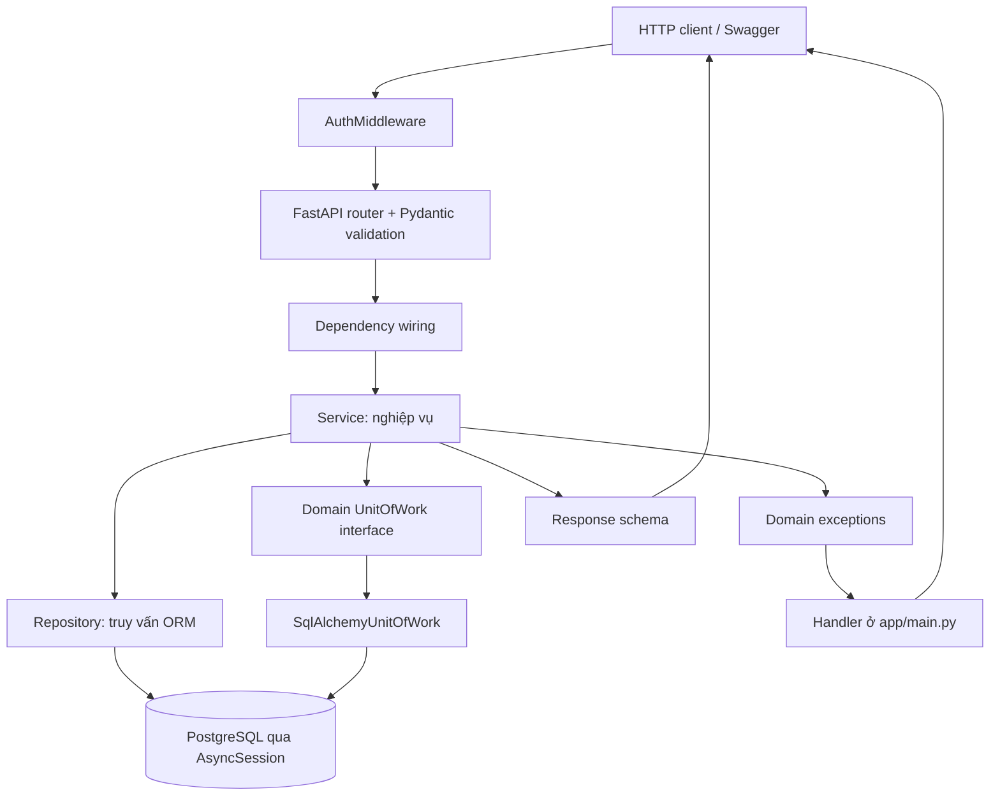
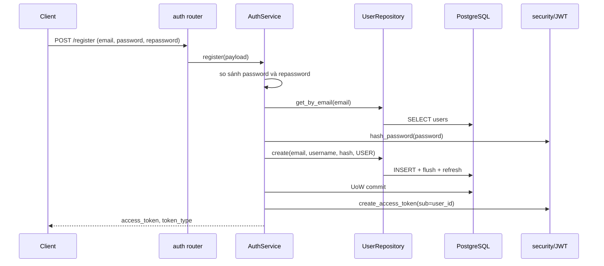
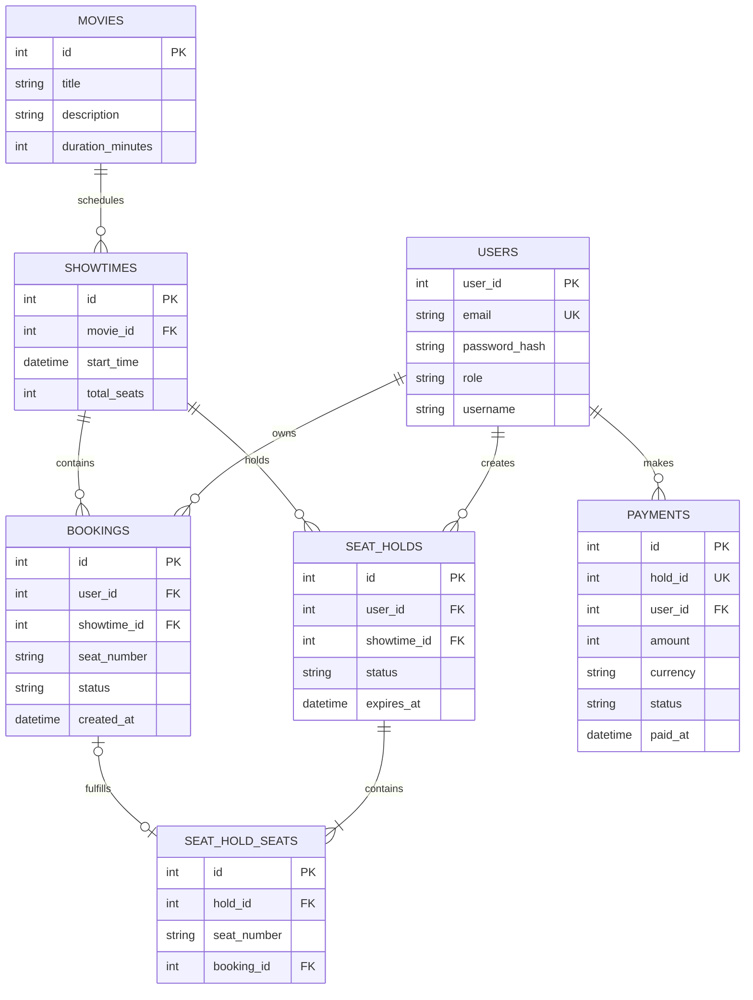

# Cinema Booking: hướng dẫn đọc code và bảo vệ đồ án

> Tài liệu được lập bằng cách đọc source hiện có trong repository. **IMPLEMENTED** là hành vi có trong code; **TESTED** chỉ dùng khi test tương ứng thực sự đã chạy và xác nhận; **INFERRED** là suy luận tĩnh; **MISSING/RISK** nêu điều chưa có hoặc nguy cơ. Source và OpenAPI runtime mới là chuẩn nếu tài liệu này lệch code.

## Phạm vi và cách dùng

Đã khảo sát các module Python dưới `app/`, launcher `main.py`, cấu hình môi trường, Docker, script khởi tạo/seed, và các test liên quan. Đã đọc call path của auth, movie, showtime, booking, hold và payment; kiểm tra fixture test và file test booking constraints. Đã thử chạy `pytest tests/unit`, nhưng không chạy được: Python trong `.venv` trỏ đến interpreter Python 3.12 không còn tồn tại; Python hệ thống không có package `pytest`. Không chạy application, integration suite, truy vấn database hay benchmark. Bộ test tích hợp yêu cầu `TEST_DATABASE_URL` trỏ đến PostgreSQL test riêng (`tests/conftest.py:95-119`); không tự dùng `DATABASE_URL` thay thế. Các nhận định runtime vì vậy chưa được xác minh.

Các đường dẫn/dòng dạng `path/to/module.py:10-20` là vị trí trong source hiện tại tại thời điểm soạn tài liệu. Mở file trực tiếp và đối chiếu trước khi dùng làm trích dẫn khi vấn đáp.

## Chương 1 — Bản đồ hệ thống

### Cách đọc sơ đồ theo code hiện tại

Ứng dụng là REST API FastAPI, không phải website có giao diện đặt vé hoàn chỉnh. Client gửi JSON qua HTTP; `app/main.py` khởi tạo app, middleware xử lý bearer token, rồi router nhận request và ghép schema/dependency. Service thực thi quy tắc nghiệp vụ; repository truy vấn ORM; `AsyncSession` kết nối PostgreSQL. `UnitOfWork` hiện chỉ bọc `commit` và `rollback`, không phải lớp điều phối repository độc lập.

Luồng không hoàn toàn “clean architecture”: service còn phụ thuộc ORM model và schema Pydantic; router còn chịu trách nhiệm dựng dependency. Sáu router được include là auth, movie, showtime, booking, payment và seat hold. Không có router/adapter cho cổng thanh toán thật, chọn ghế theo sơ đồ phòng, gửi email hay worker nền hết hạn hold.

Request không có bearer có thể đến endpoint public. Nếu client gửi bearer sai hoặc hết hạn, middleware chặn request trước route, kể cả route public. Endpoint cần đăng nhập yêu cầu identity; quyền ADMIN và quyền sở hữu được kiểm tra riêng ở tầng route/service.

### Bài toán và vai trò

Ứng dụng cung cấp REST API để xem phim, suất chiếu, trạng thái ghế; đăng ký/đăng nhập; đặt ghế trực tiếp hoặc giữ một nhóm ghế rồi thanh toán demo; xem/hủy booking cá nhân. ADMIN được phép ghi phim và tạo suất chiếu. Mã hiện tại không kết nối cổng thanh toán thật.

- **Khách chưa đăng nhập:** đọc danh sách/chi tiết phim, showtime và trạng thái ghế; đăng ký/đăng nhập.
- **USER:** thao tác booking, hold, payment thuộc tài khoản hiện tại.
- **ADMIN:** quyền USER cộng với tạo/sửa/xóa phim và tạo showtime. Role đọc từ bản ghi User trong database.

Đăng ký gán role `USER` trong `AuthService.register` (`app/services/auth_service.py:21-44`). `Role.ADMIN`/`Role.USER` là enum thuần (`app/domain/roles.py:1-7`). Không có endpoint cấp quyền admin trong routers được đăng ký.

### Stack thực tế

Python async, FastAPI, Pydantic, SQLAlchemy async, PostgreSQL/asyncpg, PyJWT, pwdlib, Docker Compose. Căn cứ: manifest `requirements.txt`, imports trong `app/main.py`, `app/db/database.py:1-25`, `app/core/security.py:1-14` và `docker-compose.yml`. Phiên bản package phải đọc từ manifest tại thời điểm chạy; tài liệu này không suy diễn số phiên bản ngoài nội dung đó.

### Kiến trúc code thực tế



Đây là phân tầng mục tiêu thể hiện qua cách nối dependency; implementation không hoàn toàn tách domain: một số service import ORM model/Pydantic schema trực tiếp. Routers tạo repository và `SqlAlchemyUnitOfWork` từ cùng session, ví dụ `app/api/booking.py:28-38`, `app/api/payment.py:16-23`; transaction của payment/booking/hold vì vậy dùng cùng session. `AuthMiddleware` mở session riêng để tìm user trước khi vào dependency của endpoint (`app/core/auth_middleware.py:14-38`).

### Vòng đời request

1. ASGI/FastAPI nhận request; `AuthMiddleware` kiểm tra header Authorization nếu có.
2. FastAPI chọn route, parse path/query/body và validate bằng Pydantic. Lỗi validation mặc định của FastAPI thường là 422.
3. `Depends` dựng service cùng repository và session; endpoint gọi service.
4. Service áp dụng quy tắc nghiệp vụ; repository thực hiện SQLAlchemy query/flush.
5. Với ghi dữ liệu, service gọi Unit of Work để commit; nếu lỗi trong khối ghi thì gọi rollback.
6. FastAPI serialize kết quả qua `response_model`; lỗi domain đi qua handler toàn cục thành `{"detail":"..."}`.

Handler và mapping exception nằm ở `app/main.py:38-68`; các router và thứ tự đăng ký ở `app/main.py:72-77`.

## Chương 2 — Cây thư mục và vai trò từng file

```text
.
├── main.py                       launcher Uvicorn cho app.main:app
├── app/
│   ├── main.py                   tạo FastAPI, middleware, exception handler, include routers
│   ├── api/                      HTTP routes và dependency wiring
│   ├── core/                     config, JWT/hash, middleware, permission, exceptions
│   ├── db/database.py            Base, engine, async session, get_db
│   ├── domain/                   Role và Protocol UnitOfWork
│   ├── models/                   ORM tables
│   ├── repositories/             truy vấn/persistence và UoW SQLAlchemy
│   ├── schemas/                  Pydantic request/response
│   └── services/                 quy tắc nghiệp vụ
├── scripts/init_db.py            tạo bảng còn thiếu bằng metadata.create_all
├── seed.py                       nạp/sync phim và showtime mẫu
├── data/movie.json               nguồn dữ liệu phim mẫu cho seeder
├── tests/                        integration tests PostgreSQL và unit tests
└── load_test/load_test.py        kịch bản Locust
```

### Entry point, core và database

| File | Trách nhiệm và điểm cần biết |
|---|---|
| `main.py:1-18` | Launcher root; chạy Uvicorn trỏ tới `app.main:app`. |
| `app/main.py:30-77` | Tạo `FastAPI`, gắn middleware, ánh xạ domain exceptions, đăng ký sáu router. |
| `app/core/config.py:5-15` | Settings đọc `.env`; bắt buộc `DATABASE_URL`, `SECRET_KEY`; mặc định algorithm HS256, token 60 phút, SQL echo false, payment 100000 VND/ghế, hold 300 giây. |
| `app/core/security.py:10-38` | Hash/verify password; phát và decode JWT. |
| `app/core/auth_middleware.py:11-46` | Parse Bearer, decode `sub`, nạp User vào request state hoặc trả 401. |
| `app/core/permission.py:7-28` | `RoleChecker`: xác thực object User trên request state và so role. |
| `app/core/exceptions.py:15-137` | Domain exception thuần Python; các lớp ownership/state/not-found/duplicate. |
| `app/db/database.py:8-37` | Declarative Base, engine với pool size 10/max overflow 20, session factory và dependency `get_db`. |
| `app/domain/__init__.py:1` | Ghi nhận package domain chứa các khái niệm nghiệp vụ không phụ thuộc framework. |
| `app/domain/roles.py:1-7` | Enum role, không phụ thuộc ORM. |
| `app/domain/unit_of_work.py:1-12` | Protocol chỉ khai báo commit/rollback. |
| `app/repositories/unit_of_work.py:1-14` | Adapter commit/rollback trên AsyncSession. |

### API, schema, service, repository và model theo module

Mỗi hàng liệt kê tất cả file ứng dụng trong module. Hàm quan trọng/luồng cụ thể được phân tích ở Chương 5–12.

| Module/file | Mục đích và liên kết |
|---|---|
| `app/api/auth.py:11-39` | `/auth`; lắp `AuthService`, route register/login/me. |
| `app/api/dependencies.py:5-29` | Lấy User từ request state; tạo `UserIdentity` hoặc public account dict. |
| `app/schemas/auth.py:1-23` | Register/Login, token response, thông tin user hiện tại. |
| `app/services/auth_service.py:12-52` | So khớp password xác nhận, tạo user, login và phát token. |
| `app/repositories/user_repository.py:7-25` | Tìm user theo id/email và insert user. |
| `app/models/user.py:8-15` | Bảng `users`; email unique; password lưu hash. |
| `app/api/movie.py:12-63` | Public read và ADMIN write cho movies. |
| `app/schemas/movie.py:5-24` | Ràng buộc title/duration và response. |
| `app/services/movie_service.py:7-60` | Read, create/update/delete; commit/rollback ghi. |
| `app/repositories/movie_repository.py:8-48` | CRUD ORM; list theo id giảm dần. |
| `app/models/movie.py:6-13` | Bảng movies. |
| `app/api/showtime.py:15-57` | Public list/seats, ADMIN create. |
| `app/schemas/showtime.py:7-24` | Input showtime, response showtime và ghế. |
| `app/services/showtime_service.py:9-59` | Xác nhận movie, dựng availability từ booking+hold. |
| `app/repositories/showtime_repository.py:8-29` | List/filter, get, create showtime. |
| `app/models/showtime.py:9-18` | Bảng showtimes; `start_time` là `DateTime` không bật timezone. |
| `app/api/booking.py:21-83` | Route đặt trực tiếp, list cá nhân, hủy. |
| `app/schemas/booking.py:6-19` | Request và response booking. |
| `app/services/booking_service.py:18-182` | Capacity/duplicate/ownership/state rules. |
| `app/repositories/booking_repository.py:11-110` | CRUD, seat lookup, multi-booking insert; không tự commit. |
| `app/models/booking.py:9-21` | Bảng bookings; status mặc định active; không khai báo unique theo seat/showtime. |
| `app/api/seat_hold.py:14-51` | Tạo/xem/giải phóng hold; toàn bộ cần identity. |
| `app/schemas/seat_hold.py:7-30` | Hold 1–5 ghế, validate số dương và không trùng trong request. |
| `app/services/seat_hold_service.py:14-126` | Tạo hold, quyền sở hữu, release/expiry và sinh ID ngẫu nhiên. |
| `app/repositories/seat_hold_repository.py:9-70` | Lưu hold/seats, lọc seat đang active và chưa hết hạn. |
| `app/models/seat_hold.py:9-40` | Hai bảng `seat_holds`, `seat_hold_seats`; booking_id unique nullable cho liên kết sau payment. |
| `app/api/payment.py:13-50` | Pay hold và list payments của tôi. |
| `app/schemas/payment.py:8-26` | Payment input/response và kết quả gồm payment + bookings. |
| `app/services/payment_service.py:15-100` | Thanh toán demo, tạo booking, gắn hold, retry idempotent khi hold đã paid. |
| `app/repositories/payment_repository.py:9-48` | Insert succeeded, tìm theo hold, list theo user. |
| `app/models/payment.py:9-26` | Bảng payments; unique `hold_id`; amount/currency/status/timestamps. |

Không thấy migration tool trong inventory file; `scripts/init_db.py:16-33` gọi `Base.metadata.create_all`, chỉ tạo bảng thiếu, không nâng cấp schema đang tồn tại. Đây là **IMPLEMENTED** theo script, không giả định schema production đồng bộ.

## Chương 3 — Khái niệm nền để đọc code

| Khái niệm | Giải thích trong dự án |
|---|---|
| HTTP method/path | Method biểu thị thao tác; path chọn route, ví dụ `POST /api/v1/bookings/`. |
| JSON/body/header | Body mang payload; header Authorization mang Bearer JWT. |
| Status code | 2xx thành công, 4xx lỗi client; app tự ánh xạ domain errors, FastAPI xử lý validation. |
| Function/class/type hints | Function là hành động; class gom state/hành vi; hint như `AsyncSession` hỗ trợ đọc/kiểm tra, không tự xác thực runtime mọi giá trị. |
| `async`/`await` | Coroutine nhường event loop khi chờ I/O; `await` không biến SQL đồng bộ thành async. App dùng async driver/repositories nhưng test fixtures có adapter đồng bộ. |
| Decorator | `@router.get(...)` đăng ký hàm làm endpoint và khai báo metadata/response model. |
| Dependency injection | `Depends(get_db)`/`Depends(get_booking_service)` cho FastAPI tạo và truyền dependency. Giúp tái sử dụng và override trong test. |
| Pydantic schema | Ranh giới dữ liệu HTTP: validate input, định hình response. Khác ORM model là biểu diễn bảng database. |
| ORM / SQLAlchemy | `Mapped`/`mapped_column` khai báo cột; repository dùng `select`, `session.get`, `add`, `flush`. |
| Session | Đại diện đơn vị làm việc/identity map; session không đồng nghĩa một câu SQL hay một transaction đã commit. |
| `flush` | Gửi pending changes trong transaction để DB cấp ID/kiểm tra constraint; chưa commit, nên rollback vẫn có thể hủy. |
| `commit`/`rollback` | Commit chốt transaction; rollback hủy thay đổi chưa commit. UoW adapter gọi trực tiếp hai API này. |
| Repository | Đóng gói query và persistence; hiện repository dùng ORM model, session được truyền từ router dependency. |
| Unit of Work | Giao diện ranh giới transaction; ở đây chỉ có `commit`/`rollback`, implementation SQLAlchemy giữ cùng session. |
| Middleware | Bao quanh request trước endpoint; middleware auth nạp User vào `request.state`. |
| Authentication/authorization | Authentication xác nhận danh tính; authorization kiểm tra quyền role hoặc quyền sở hữu resource. JWT hợp lệ không tự đồng nghĩa quyền ADMIN. |
| JWT | Token ký chứa `sub` user id và `exp`; không mã hóa kín dữ liệu payload. Role hiện được lấy lại từ DB theo User. |
| Password hashing | Hash một chiều chậm dùng để lưu/verify; code không lưu password thuần trong model. |
| Fixture/mock | Fixture chuẩn bị môi trường/dữ liệu; mock/fake thay dependency để unit test không cần DB thật. |

### Ba phân biệt dễ nhầm khi trình bày

- **Validate khác quy tắc nghiệp vụ:** Pydantic có thể từ chối seat label sai định dạng với 422; ghế có đang bị booking/hold chiếm hay không do service truy vấn dữ liệu.
- **Flush khác commit:** `flush()` gửi SQL trong transaction và thường cấp ID, nhưng dữ liệu chưa được chốt. Commit thành công mới kết thúc transaction; rollback không thể đảo ngược commit đã hoàn tất.
- **Async khác chạy song song:** `async/await` giúp event loop xử lý việc khác khi chờ I/O. Nó không tự serialize hai yêu cầu đặt cùng ghế và không bảo đảm invariant dữ liệu.

Response schema cũng không phải bản sao của ORM model: endpoint khai báo `response_model` để định hình payload công khai. Không nên suy luận mọi cột DB đều được trả cho client.

## Chương 4 — Tính năng và trạng thái bằng chứng

Các nhãn ở chương này nói về mức bằng chứng: **IMPLEMENTED** nghĩa là có đường code tương ứng; **TEST SOURCE EXISTS** nghĩa là repository có test source; chỉ **TESTED** mới có nghĩa test đã chạy thành công trong môi trường cụ thể. Trong lượt rà soát này chưa có test nào được xác nhận TESTED. Tên file test hoặc assertion trong file không chứng minh runtime hiện tại đã hoạt động.

| Tính năng | Code | Test trong repo | Giới hạn |
|---|---|---|---|
| Register/login/JWT | **IMPLEMENTED** `auth_service.py`, `security.py` | Có unit và integration test auth theo tên/hàm ở `tests/unit/test_auth.py`, `tests/test_auth.py`; chưa chạy ở lượt này. | Không thấy policy độ dài/phức tạp password hoặc refresh token. |
| Public movie/showtime read | **IMPLEMENTED** routers/services/repos | Có integration/unit files tương ứng. | Không có pagination/search nâng cao. |
| ADMIN movie write/showtime create | **IMPLEMENTED** `RoleChecker(Role.ADMIN)` ở decorator router | Có test quyền admin ở auth/movie/showtime. | Xóa movie đang được tham chiếu có thể bị FK từ chối; chưa thấy ánh xạ riêng lỗi đó. |
| Direct one-seat booking | **IMPLEMENTED** | Unit + integration booking tests. | Kiểm tra trùng là check-then-insert, không atomic với constraint DB. |
| Multi-seat hold | **IMPLEMENTED** | Trong inventory không thấy file test riêng cho hold service/router. | Race giữa hold/booking/payment chưa được khóa ở DB. |
| Demo payment | **IMPLEMENTED** | Không thấy test payment trong test file inventory. | Không gateway thật; payment status hiện ghi succeeded. |
| Load test | Script `load_test/load_test.py` | Chưa chạy; tài liệu `LOAD_TEST_PLAN.md` nói kịch bản booking trực tiếp. | Không benchmark thay thế môi trường triển khai; không test hold/payment. |

`tests/test_booking_constraints.py` tự ghi đây là legacy test được skip (`pytestmark` ở đầu file); test mô tả partial unique index/race nhưng model hiện không khai báo index đó. Vì thế không coi các assertion đó là xác nhận hiện trạng. Chỉ test thật được chạy mới nhận nhãn **TESTED** cho phiên làm việc.

## Chương 5 — Truy vết các luồng end-to-end

### A. Đăng ký và đăng nhập



Evidence: router/service wiring `app/api/auth.py:11-39`; validation/business and commit `app/services/auth_service.py:21-52`; repository insert `app/repositories/user_repository.py:13-25`; hashing/JWT `app/core/security.py:16-38`.

Thứ tự đáng hiểu: mật khẩu confirmation được so sánh trước query; email query kiểm tra trùng ở service; role được đặt cố định `USER`; create repository flush/refresh; service commit; chỉ sau commit phát JWT. Email unique ở DB bảo vệ trùng cuối cùng, nhưng cạnh tranh đăng ký có thể vượt qua precheck và tạo lỗi DB chưa được ánh xạ thành `EmailAlreadyExistsError`.

### B. Request có Bearer và authorization

1. Middleware đặt `request.state.current_user = None`.
2. Không có Authorization: request tiếp tục; route public có thể chạy, route cần identity sẽ bị 401.
3. Có Authorization: phải parse thành Bearer + token không rỗng; token sai chặn request với 401, kể cả route public.
4. `decode_access_token` verify JWT qua PyJWT, lấy claim `sub`, cast sang int.
5. Middleware mở `AsyncSessionLocal`, truy vấn User theo ID; user không còn trong DB => 401.
6. Gắn ORM User vào request state; dependency `get_current_user` trả `{id, role}` kiểu `UserIdentity`; `get_current_user_account` trả `user_id/email/role`.
7. Các route admin thêm `RoleChecker(Role.ADMIN)`, còn booking/hold/payment gọi dependency identity. Việc sở hữu tài nguyên được service kiểm tra riêng.

Evidence: `app/core/auth_middleware.py:14-46`, `app/core/security.py:24-38`, `app/api/dependencies.py:10-29`, `app/core/permission.py:13-28`, các router tương ứng.

Nuance: middleware mở session truy vấn user riêng, rồi dependency DB của route dựng session khác. Vì middleware đóng session trước `call_next`, ORM User trong request state có thể đã detached; code dependencies chỉ đọc trường scalar, nhưng đây vẫn là coupling/lifecycle cần nắm.

### C. Tạo booking trực tiếp

`POST /api/v1/bookings/` body `showtime_id` + `seat_number`; `BookingCreate` yêu cầu regex `^[1-9][0-9]*$`. FastAPI validate trước endpoint. Endpoint lấy ID từ UserIdentity, không lấy owner từ body. Service:

1. Lấy showtime, không có thì `NotFoundError`.
2. Parse nhãn ghế sang int, so với `total_seats`; quá sức chứa cũng trả not found.
3. Query booking active cùng `(showtime_id, seat_number)`.
4. Nếu có hold repository, query seat đang thuộc hold active/chưa hết hạn.
5. Tạo ORM booking với user id đã xác thực, flush; service commit rồi trả response.

Evidence: schema `app/schemas/booking.py:6-19`; route `app/api/booking.py:41-54`; service `app/services/booking_service.py:44-110`; repository `app/repositories/booking_repository.py:21-33,76-110`.

Lỗi: schema sai => FastAPI 422; showtime/ghế ngoài capacity => `NotFoundException`/404; ghế active hoặc held => `DuplicateSeatError`/400. **RISK:** kiểm tra và INSERT không nằm trong một cơ chế loại trừ; hai request có thể cùng thấy ghế trống rồi cùng ghi. Không thấy unique constraint trên bảng Booking.

### D. Hủy booking

`DELETE /api/v1/bookings/{booking_id}` gọi `get_by_id`, kiểm tra tồn tại, kiểm tra `booking.user_id == user_id`, yêu cầu `status == active`, update status `cancelled`, flush/commit. Không xóa row. Khi availability query, chỉ booking active chiếm ghế nên sau hủy ghế hiện available.

Evidence: `app/api/booking.py:69-83`, `app/services/booking_service.py:127-182`, `app/repositories/booking_repository.py:35-51,93-100`, `app/services/showtime_service.py:39-59`.

Mã lỗi: not found 404; ownership 403; trạng thái không active 400. Authorization đúng vì ID chủ thể đến từ JWT còn ownership được service xác nhận trên resource.

### E. Tạo hold

Schema yêu cầu showtime id dương, 1–5 seat string duy nhất, regex số dương. Service xác nhận showtime và capacity; lấy tập booking active và hold active `expires_at > now`; nếu một ghế bận thì từ chối cả nhóm; sinh ID dương ngẫu nhiên (tối đa 20 lần dò không trùng hold/payment reference); gán `created_at`, `expires_at = now + TTL`; repository thêm Hold và các Seat rows; commit.

Evidence: `app/schemas/seat_hold.py:7-19`, `app/services/seat_hold_service.py:29-66,104-115`, `app/repositories/seat_hold_repository.py:16-60`, `app/core/config.py:13-14`.

Release: chủ hold mới được giải phóng; chỉ status active; nếu đã quá hạn thì ghi `expired`, nếu còn hạn thì `released`; commit trả trạng thái. Get hold tính response `expired` theo thời gian nhưng không persist trạng thái đó. Ghế hết hạn không bị chặn vì query availability lọc theo thời gian, không cần worker.

### F. Thanh toán demo cho hold

`POST /api/v1/payments` nhận hold_id dương. Service kiểm tra hold tồn tại và thuộc user. Các nhánh:

1. `paid` và payment tồn tại: đọc các booking được liên kết, trả cùng kết quả với cờ `created=False`; route đổi status thành 200 (retry idempotent theo mã hiện tại).
2. Không active: `HoldStateError` => 409.
3. Đã quá hạn: mark expired, commit trạng thái rồi ném `HoldExpiredError` => 409; nhánh lỗi này không rollback lại trạng thái đã commit.
4. Payment reference đã có khi hold chưa paid: conflict state, tránh nhận nhầm payment cũ.
5. Xác nhận không có booking active nào chiếm seat trong hold.
6. Tạo payment succeeded với `DEMO_PAYMENT_AMOUNT_VND * số ghế`; tạo booking cho từng seat; gắn booking_id từng SeatHoldSeat; chuyển hold sang paid; một commit chốt cả thay đổi.

Evidence: `app/api/payment.py:25-50`, `app/services/payment_service.py:30-89`, `app/repositories/payment_repository.py:15-48`, `app/repositories/booking_repository.py:102-110`, `app/repositories/seat_hold_repository.py:65-70`.

Nếu bước sau insert/payment thất bại, service rollback nên tránh trạng thái payment/booking/hold chỉ commit một phần trong transaction thông thường. **RISK:** chưa có row lock/atomic claim hold; hai thanh toán đồng thời có thể cùng qua các bước check. Unique payment.hold_id có thể chặn một insert payment, nhưng không thay thế chiến lược concurrency bao quát hay xác nhận hoàn chỉnh khi cạnh tranh.

## Chương 6 — Mô hình dữ liệu và quan hệ



ERD phản ánh FK/unique khai báo trong ORM, không phải toàn bộ quy tắc nghiệp vụ. Đặc biệt không có constraint duy nhất `(showtime_id, seat_number)` cho active Booking; payment `hold_id` unique nhưng không có ForeignKey tới `seat_holds.id` trong `app/models/payment.py:9-26`. `SeatHoldSeat` có unique booking_id nullable, nhưng không khai báo unique `(hold_id, seat_number)`.

### Các trạng thái

- Booking: tạo `active`; chỉ transition code `active -> cancelled`; không tái kích hoạt.
- Hold: tạo `active`; release thành `released`, hết hạn có thể trả/ghi `expired`, thanh toán thành `paid`.
- Payment: repository hiện chỉ tạo `succeeded`; không thấy luồng failed/refund.

Giá trị status là string, không phải database enum/check constraint. Quy tắc chuyển trạng thái hiện ở service, không được DB cưỡng chế đầy đủ.

### Khóa và ranh giới toàn vẹn

`users.email` là unique; showtime tham chiếu movie; booking tham chiếu user/showtime; hold tham chiếu user/showtime; mỗi hold seat tham chiếu hold và `booking_id` nullable có unique constraint; payment tham chiếu user và có `hold_id` unique nhưng không có FK tới hold. Các khóa này bảo vệ một số quan hệ, nhưng không bảo đảm một ghế trong một suất chỉ có một booking/hold khi có request đồng thời.

`total_seats` chỉ cho phép biểu diễn ghế bằng số `1..N`, chưa có thực thể phòng/ghế hoặc hàng-cột. Availability là kết quả tổng hợp từ booking active và hold active chưa hết hạn, không phải bảng inventory riêng. Hold hết hạn có thể được tính khi đọc; chỉ một số nhánh như payment/release mới ghi trạng thái expired vào DB.

## Chương 7 — Catalog API đã đăng ký

Tất cả endpoint bên dưới có prefix thật từ router; sáu router include tại `app/main.py:72-77`. Public nghĩa là không cần JWT khi không gửi Authorization; middleware vẫn từ chối token sai nếu client tự gửi token.

| Method và path | Auth/quyền | Thành công | Nguồn |
|---|---|---:|---|
| `POST /api/v1/auth/register` | Public | 200 | `app/api/auth.py:18-25` |
| `POST /api/v1/auth/login` | Public | 200 | `app/api/auth.py:27-34` |
| `GET /api/v1/auth/me` | JWT | 200 | `app/api/auth.py:36-39` |
| `GET /api/v1/movies` | Public | 200 | `app/api/movie.py:19-23` |
| `GET /api/v1/movies/{movie_id}` | Public | 200 | `app/api/movie.py:25-29` |
| `POST /api/v1/movies` | ADMIN | 200 | `app/api/movie.py:31-39` |
| `PUT /api/v1/movies/{movie_id}` | ADMIN | 200 | `app/api/movie.py:41-53` |
| `DELETE /api/v1/movies/{movie_id}` | ADMIN | 204 | `app/api/movie.py:55-63` |
| `GET /api/v1/showtimes?movie_id=` | Public | 200 | `app/api/showtime.py:28-35` |
| `POST /api/v1/showtimes` | ADMIN | 201 | `app/api/showtime.py:37-49` |
| `GET /api/v1/showtimes/{id}/seats` | Public | 200 | `app/api/showtime.py:51-57` |
| `POST /api/v1/bookings/` | JWT | 201 | `app/api/booking.py:41-54` |
| `GET /api/v1/bookings/me` | JWT | 200 | `app/api/booking.py:56-67` |
| `DELETE /api/v1/bookings/{id}` | JWT + owner | 200 | `app/api/booking.py:69-83` |
| `POST /api/v1/holds` | JWT | 201 | `app/api/seat_hold.py:27-34` |
| `GET /api/v1/holds/{id}` | JWT + owner | 200 | `app/api/seat_hold.py:36-43` |
| `DELETE /api/v1/holds/{id}` | JWT + owner | 200 | `app/api/seat_hold.py:45-51` |
| `POST /api/v1/payments` | JWT + hold owner | 201 new; 200 retry | `app/api/payment.py:25-43` |
| `GET /api/v1/payments/me` | JWT | 200 | `app/api/payment.py:45-50` |

Response/schema: auth `app/schemas/auth.py`; movie `movie.py`; showtime `showtime.py`; booking `booking.py`; hold `seat_hold.py`; payment `payment.py`. HTTP payload validation errors are FastAPI/Pydantic concerns; domain exceptions mapped centrally. Do not infer endpoints absent from these routers.

### Hợp đồng theo nhóm chức năng

- **Auth:** register nhận thông tin tài khoản và trả token; login trả access token; `/auth/me` yêu cầu JWT. Không có API refresh token trong catalog.
- **Catalog:** movie list/detail và showtime list/seats là public read. Movie write dành cho ADMIN; showtime create dành cho ADMIN. Movie list sắp theo ID giảm dần; showtime list theo start time tăng dần, có filter `movie_id`.
- **Booking:** tạo một booking cho một seat label bằng số; `/bookings/me` liệt kê booking của identity hiện tại; DELETE là hủy mềm qua status, không xóa row.
- **Hold/payment:** hold hỗ trợ nhóm 1–5 ghế theo schema; get/release yêu cầu chủ hold. Payment tạo payment demo cho hold, có retry response 200 khi hold đã paid và payment hiện hữu.

Các thành công trong bảng là status code khai báo ở route; lỗi có thể kết thúc bằng 401/403/404/409/422 hoặc 500 tùy exception và mapping. Không coi mã status thành công là bằng chứng rằng request đã chạy trong DB thật.

## Chương 8 — Authentication và authorization

Đăng ký kiểm tra confirmation, tra email trùng, băm mật khẩu, tạo user role `USER`, flush/refresh rồi commit; access token chỉ được tạo sau commit. Login dùng thông báo lỗi chung cho email không tồn tại và mật khẩu sai. Không thấy policy độ mạnh mật khẩu, refresh token, logout/revocation store hoặc giới hạn tốc độ trong luồng auth đã rà.

JWT chứa `sub` là ID user dạng chuỗi và thời điểm hết hạn; chữ ký HS256 được kiểm tra khi decode. Middleware không tin role trong token: nó tìm user hiện tại theo ID, nên đổi role hoặc xóa user có thể ảnh hưởng request kế tiếp dù token chưa hết hạn. Middleware tạo session riêng trước khi dependency mở session cho route; User trong request state có thể detached sau khi session middleware đóng, hiện dependencies chỉ đọc scalar fields.

### JWT flow

`create_access_token` copies input claim dict, appends UTC expiration (default configured 60 minutes), signs using configured algorithm/key. Register/login set `sub` to string user ID. `decode_access_token` calls `jwt.decode` with allowed algorithm list; PyJWT verifies signature and expiration, then wraps `jwt.InvalidTokenError` as domain `InvalidTokenError` (`app/core/security.py:24-38`). Middleware casts `sub` to int and catches missing/invalid claims (`auth_middleware.py:20-27`).

JWT payload is signed, not encrypted; do not put password/secret in claims. Role is not sourced from a role claim here; middleware reloads DB User and `RoleChecker` compares current role. This means role change can affect subsequent requests using existing token, absent a separate cache.

### Ownership is separate from role

RoleChecker protects ADMIN movie writes and showtime create. Booking routes require authenticated identity but do not require ADMIN. BookingService/SeatHoldService/PaymentService compare resource owner IDs. An ADMIN does not bypass ownership for other users' bookings/holds/payments.

### Security choices and gaps

- Password storage uses `PasswordHash.recommended()` and verify function, not plaintext (`app/core/security.py:10-21`). Actual algorithm is delegated to library defaults; no runtime inspection was done.
- Login uses the same `InvalidCredentialsError` message for unknown email and wrong password, reducing account enumeration through response difference (`auth_service.py:46-52`).
- Registration schema has required strings but no visible length/complexity/email-normalization policy (`app/schemas/auth.py:4-12`).
- Config sample values are development defaults; `docker-compose.yml` has a fallback SECRET_KEY. Must replace outside local use; this is configuration evidence, not a runtime breach finding.
- No refresh/revocation endpoint found. Token lifetime limits exposure but does not provide immediate revocation except deleting/inactivating user (middleware reloads DB).
- Middleware validates any Authorization header before route selection, so malformed/expired token can make a public read fail 401.

## Chương 9 — Async, session, transaction

Engine async lấy cấu hình từ environment; session maker đặt `expire_on_commit=False`, `autoflush=False`, `autocommit=False`, pool `pool_size=10` và `max_overflow=20`. Dependency `get_db` yield session, rollback nếu lỗi thoát qua dependency, rồi đóng session. Service thường gọi repository `flush`, sau đó UoW commit; luồng thanh toán ghi payment, bookings, liên kết hold seats và đổi trạng thái hold trong cùng transaction.

Transaction bảo vệ tính nguyên tử trong một session/DB transaction; nó không thay cho khóa hoặc constraint chống hai transaction cạnh tranh. Các bước “đọc ghế trống rồi ghi booking/hold” có khoảng thời gian cạnh tranh. Fixture tích hợp dùng adapter sync và override dependency, do đó không mặc định test đi qua cùng middleware/session lifecycle như ứng dụng chạy thật.

`create_async_engine` binds asyncpg URL from settings; pool configured at 10 connections + 20 overflow. `async_sessionmaker` uses `expire_on_commit=False`, `autoflush=False`; `get_db` yields a session and rolls back if an exception escapes, then closes (`app/db/database.py:10-37`).

Repositories call `flush`, often `refresh`, and generally do not commit (`booking_repository.py:21-33`; `movie_repository.py:22-53`). This lets services compose multiple writes before commit. `SqlAlchemyUnitOfWork` holds the same session object and delegates commit/rollback (`app/repositories/unit_of_work.py:4-14`). Payment uses one session to create payment, bookings, attach booking IDs, update hold then commit once (`app/services/payment_service.py:62-83`).

Important distinctions:

- `flush()` sends SQL inside the open transaction; it does not mean durable commit.
- `commit()` makes the transaction durable; later rollback cannot undo it.
- `rollback()` undoes uncommitted work, not prior commits.
- Read routes generally do not explicitly commit; session closes after response dependency lifecycle.
- If transaction commit throws, service catch attempts rollback then rethrows; HTTP handler only knows mapped domain exception classes, so unexpected SQL errors may become 500.
- Expired-payment path deliberately commits `expired` before raising; `except HoldExpiredError` skips rollback.

Design benefit: transaction ownership is more explicit than committing in every repository. Limitation: UoW Protocol only exposes low-level commit/rollback and does not guarantee rollback semantics, transaction context management, or atomic concurrency control by itself.

## Chương 10 — Configuration and local operations

Ứng dụng đọc cấu hình từ environment qua `app/core/config.py`; biến quan trọng gồm URL database, JWT secret/algorithm/TTL, TTL hold và giá demo mỗi ghế. `.env.example` là mẫu, không ghi secret thật vào tài liệu. `main.py` chạy Uvicorn ở `127.0.0.1:8000` với reload mặc định khi gọi trực tiếp. Docker khởi tạo DB bằng `scripts/init_db.py` rồi chạy Uvicorn; `metadata.create_all` không thay thế migration có version. Seed dữ liệu là bước riêng.

Compose wiring mô tả app và PostgreSQL nhưng tài liệu này không xác nhận container đã chạy. Tên environment giữa local, test và container phải được đối chiếu trước khi chạy integration test; chỉ dùng DB test/local có thể tạo bảng hoặc thay đổi dữ liệu.

| Setting | Required/default | Meaning |
|---|---|---|
| `DATABASE_URL` | required | SQLAlchemy async DB URL; Compose uses hostname `db`, host Python uses localhost by sample. |
| `SECRET_KEY` | required by Settings | JWT signing secret; sample Compose fallback is local-only. |
| `ALGORITHM` | `HS256` | JWT signing algorithm. |
| `ACCESS_TOKEN_EXPIRE_MINUTES` | `60` | Token expiry. |
| `SQL_ECHO` | `False` | SQLAlchemy SQL logging toggle. |
| `DEMO_PAYMENT_AMOUNT_VND` | `100000`, >0 | Fixed amount per held seat. |
| `SEAT_HOLD_TTL_SECONDS` | `300`, >=1 | Hold lifetime. |

`app/core/config.py:5-15`; sample `.env.example`; Compose forwards config at `docker-compose.yml:25-35`. Compose service healthcheck/dependency ordering is in `docker-compose.yml`; container API runs `scripts/init_db.py` before serving according to Dockerfile/Compose command. `create_all` is not a migration. Seed separately through `seed.py` and `data/movie.json`; source reference `seed.py:17-104`. Full local run instructions live in README and are intentionally not duplicated here.

`load_test/` provides a separate Locust workload. Its plan says unique seat ranges and valid JWT/showtime are prerequisites; that workload creates direct bookings and lists bookings, not a test of same-seat contention or hold/payment.

## Chương 11 — Findings, limitations, and improvements to defend honestly

### Bằng chứng, tác động và hướng xử lý

| Mức | Quan sát trong code | Tác động có thể xảy ra | Hướng xử lý phù hợp |
|---|---|---|---|
| Cao | Booking/hold kiểm tra availability rồi mới insert; không thấy constraint thống nhất cho seat reservation | Hai request cạnh tranh có thể cùng chiếm ghế | Thiết kế invariant ở DB, xử lý conflict thành lỗi nghiệp vụ, kiểm thử đa connection |
| Cao | Payment kiểm tra hold rồi ghi nhiều bảng; không có row lock/CAS | Payment/release hoặc hai payment có thể cạnh tranh | Claim trạng thái nguyên tử/row lock, idempotency key, kiểm thử cạnh tranh |
| Trung bình | Registration precheck email rồi insert; unique DB là chốt cuối | Race có thể tạo IntegrityError thay vì response 409 dự kiến | Bắt unique constraint và ánh xạ ổn định |
| Trung bình | Schema tạo bằng `create_all`; không thấy migration có version trong luồng triển khai đã rà | Khó tiến hóa schema có kiểm soát giữa môi trường | Dùng migration và quy trình upgrade/rollback |
| Trung bình | Datetime showtime không thể hiện chính sách timezone rõ trong model/schema | Diễn giải giờ chiếu lệch giữa client/server | Chuẩn hóa UTC, lưu timezone-aware, kiểm thử offset/boundary |
| Trung bình | Test fixture tạo schema trước khi import toàn bộ model hold/payment | Test integration có thể thiếu bảng mới hoặc không phủ đúng luồng | Import model registry đầy đủ trước create_all và thêm test hold/payment |
| Thấp | Payment luôn mô phỏng `succeeded` | Không có xác nhận/đối soát từ nhà cung cấp | Khi cần, thêm gateway adapter, webhook, idempotency và reconciliation |

Mức độ trên là đánh giá tĩnh về khả năng tác động, không phải sự cố quan sát ở production. Hướng xử lý là đề xuất, không mô tả behavior hiện hành.

Severity here is relative to the current demo scope, not a penetration-test result. Every finding is based on static code inspection.

### HIGH — seat duplication race (RISK)

BookingService does a SELECT precheck followed by INSERT. No DB unique constraint or lock on active `(showtime_id, seat_number)` appears in `Booking` model. Two concurrent requests can interleave and both insert. Hold uses analogous read/check/create. Payment checks then writes too. Proposed direction: choose database-enforced invariant (e.g. PostgreSQL partial unique index for active booking) plus conflict translation; design hold-vs-booking arbitration too, since a booking index alone does not reserve seats against holds. Add transaction/concurrency tests using independent connections before claiming fixed. Do not add index blindly to existing duplicates without a migration/cleanup plan.

### HIGH — check-then-act around expiry/payment (RISK)

Payment reads hold state/expiry, then writes payment/booking/status without `SELECT FOR UPDATE`, compare-and-set, or another serialized claim. Concurrent pay/release or multiple requests can race. Use a DB transaction lock/conditional update and idempotency key/provider callback model if integrating real payments. `payments.hold_id` unique is a safety net for one row, not a full workflow lock.

### MEDIUM — schema lifecycle (RISK)

`create_all` adds missing tables but does not alter existing tables. Evolving columns/indexes requires a migration strategy (e.g. Alembic) and controlled deploys. Existing database may not match model source.

### MEDIUM — timezone contract (RISK)

`Showtime.start_time` is plain SQLAlchemy `DateTime` without `timezone=True`, while clients can send offset-aware datetime. Define UTC policy, normalize input, and use timezone-aware DB column consistently. Current API does not enforce future time or overlapping showtimes.

### MEDIUM — registration uniqueness race/error mapping (RISK)

Service prechecks email, model has unique email, but simultaneous registration can still hit DB `IntegrityError`; no explicit conversion appears in service/repository. Translate DB uniqueness conflict to stable 409 after rollback.

### MEDIUM — behavior/documentation/test mismatch (BUG in stale tests/docs, not runtime feature)

Legacy `tests/test_booking_constraints.py` describes a partial unique index and error translation that current ORM/repository code does not implement; whole module is marked skipped. Old `BOOKING_CONTRACT.md` was replaced during prior documentation work; README may still describe details requiring source comparison. Treat source as current truth and update stale tests/docs. Do not cite skipped test expectation as implemented behavior.

### MEDIUM — test coverage for newer flows (NOT VERIFIED)

Inventory contains no dedicated test module named for seat holds/payments. Add unit and API tests for ownership, expiration boundary, release, retry, transactional rollback, amount, and concurrent behavior before production claims. This is an inventory observation, not a coverage percentage.

### LOW — dependency/architecture seam

Some services import ORM models/Pydantic schemas; this makes “domain independent of infrastructure” only partly true. `get_current_user_account` is named account but returns dict. Improvement: clarify service contracts, type repository/UoW interfaces, keep HTTP schema conversion at edge if the project wants stronger layering.

`app/models/user.py` imports `Role` but defines `role` as a plain string column and does not reference the imported enum elsewhere in that file. This is an apparent unused import in the current file, not a behavior defect.

### LOW — query/product limits

Movie list/showtime list have no pagination. No cinema/room entity or visual row-column seat map exists; seats are numeric labels generated from capacity. Payment amount is fixed per seat. These are scope limits, not necessarily defects for a class project.

## Chương 12 — Đọc code theo đoạn quan trọng

Khi bảo vệ, trình bày theo thứ tự **HTTP contract → dependency/auth → service decision → repository query/write → transaction → response/error mapping**. Cách này phân biệt 422 do schema, 401/403 do auth/authorization, lỗi nghiệp vụ do service và constraint DB. Với mỗi nhận định, mở symbol/file cụ thể; sơ đồ không thay cho bằng chứng source.

### 12.1 Endpoint khai báo dependency và schema

`app/api/booking.py:41-54`:

```python
@router.post("/", response_model=BookingResponse, status_code=201)
async def create_booking(payload, current_user=Depends(get_current_user),
                         service=Depends(get_booking_service)):
    return await service.create_booking(user_id=current_user.id, payload=payload)
```

Decorator gắn method/path/response/status vào FastAPI. `payload` được parse từ body và validate theo `BookingCreate`; `Depends` lấy identity và dựng service. Endpoint không tự chọn owner từ JSON: chỉ truyền `current_user.id`. Kết quả ORM object được response model chuyển thành JSON.

### 12.2 `flush` tách khỏi commit

`app/repositories/booking_repository.py:21-33`: repository lọc key `user_id` khỏi payload, dựng `Booking(..., user_id=user_id)`, add, flush, refresh. Lọc thêm ở repository là defense-in-depth chống caller override. Flush làm INSERT trong transaction để có ID/DB errors; commit do service/UoW.

### 12.3 Auth middleware

`app/core/auth_middleware.py:14-38`: khởi đầu với user None; parse Bearer; decode JWT; lấy `sub`; mở session và gọi `UserRepository.get_by_id`; gắn entity lên request state; gọi `call_next`. Middleware chỉ xác nhận danh tính, không áp role.

### 12.4 Seat availability

`app/services/showtime_service.py:39-59`: kiểm tra showtime tồn tại; lấy tập booking active; lấy tập hold có active status và expires_at sau `now`; sinh `1..total_seats`; availability là phần tử không nằm trong cả hai tập. Đây là snapshot theo thời điểm query, không phải cam kết rằng ghế sẽ còn trống khi request sau ghi.

### 12.5 Payment transaction

`app/services/payment_service.py:30-89`: đọc hold, xác nhận owner/trạng thái/expiry; nhánh retry paid đọc lại bookings; nhánh mới tạo payment, bookings, liên kết, đánh dấu paid rồi commit. Với thảo luận cần chỉ ra transaction giúp tránh partial success khi lỗi tuần tự, nhưng không tự loại trừ transaction cạnh tranh.

## Chương 13 — Tests và cách kiểm chứng

### Cấu hình

- Integration tests: `tests/conftest.py:95-119` yêu cầu `TEST_DATABASE_URL`, không fallback sang `DATABASE_URL`.
- Fixture engine dùng PostgreSQL test và `Base.metadata.create_all` (`tests/conftest.py:137-150`).
- Mỗi test bọc transaction ngoài + savepoint; cuối test rollback (`tests/conftest.py:163-196`).
- Integration app dùng proxy chuyển các method async repository sang SQLAlchemy sync session; middleware session factory được monkeypatch và dependency DB được override (`tests/conftest.py:200-305`). Vì proxy delegate đồng bộ, đây là seam test, không phải mô phỏng hiệu năng async.
- Fixture integration import/register Booking/Movie/Showtime/User (`tests/conftest.py:125-131`) rồi gọi `Base.metadata.create_all()` trong fixture engine (`tests/conftest.py:137-150`). `app.main` chỉ được import trong fixture request/client sau khi fixture database đã khởi tạo (`tests/conftest.py:254-274,382-399`); import đó mới kéo các router hold/payment vào. Do đó SeatHold/Payment không được đăng ký vào metadata trước lệnh `create_all()` trong luồng integration hiện tại; chưa có cơ sở nói setup integration xác minh schema mới.
- Override `get_booking_service` trong fixture tạo `BookingService` chỉ với booking/showtime repositories (`tests/conftest.py:293-302`), không truyền SeatHoldRepository hoặc UnitOfWork. Vì vậy API booking integration qua override không bao phủ nhánh hold-aware của wiring production.
- `tests/unit/` dùng fake repositories/in-memory object, không cần PostgreSQL. Cấu hình pytest ở `pytest.ini`.

### Coverage có thể xác định từ inventory

Khi đọc test, cần ghi nhận **đối tượng được kiểm tra**, **dependency được thay thế**, **database/schema được dùng**, và **lệnh đã chạy**. Unit test với fake xác minh logic service trong phạm vi fixture; nó không tự chứng minh SQL, middleware thật, FK hay hành vi đồng thời của PostgreSQL. Integration test có source nhưng setup model registry chưa đầy đủ cho hold/payment, nên không suy ra các luồng đó đã được tích hợp kiểm chứng.

- Auth: registration, password mismatch, duplicate email, login, token invalid, RoleChecker (`tests/unit/test_auth.py`); HTTP auth/permissions (`tests/test_auth.py`).
- Booking: input validation/capacity/duplicate, owner, cancel/state, list isolation (`tests/unit/test_booking.py`, `tests/test_booking.py`).
- Movie/showtime: unit + HTTP tests, gồm role/write/validation paths.
- Booking constraints: file legacy skipped; không chứng minh hiện model constraint có hiệu lực.
- Hold/payment: không tìm thấy file test chuyên biệt trong `tests` inventory đã đọc; coi là khoảng trống cần xác minh, không kết luận không có coverage ở nơi ngoài inventory.

**Kết quả chạy:** đã thử `.\.venv\Scripts\python.exe -m pytest tests/unit`, nhưng launcher không tìm thấy Python 3.12 theo đường dẫn đã lưu trong virtual environment. `python -m pytest tests/unit` với Python hệ thống cũng thất bại vì không cài `pytest`. Vì vậy chưa có test nào được xác nhận TESTED ở lượt này. Integration chỉ chạy sau khi xác nhận `.env.test`/`TEST_DATABASE_URL` trỏ tới DB test được phép tạo bảng. Không đưa credential vào tài liệu.

### Checklist test thủ công qua Swagger (dùng DB test/local)

1. Register account mới -> nhận bearer; `GET /auth/me` -> đúng user/role USER.
2. Không token gọi movie/showtime list -> response public; request cần booking không token -> 401.
3. USER tạo movie/showtime -> 403; ADMIN gọi -> thành công.
4. Chọn showtime có sức chứa N; query seats -> N nhãn `1..N`.
5. Booking ghế hợp lệ -> 201; lặp lại -> 400; ghế N+1 hoặc showtime thiếu -> 404; malformed seat -> 422.
6. User B hủy booking user A -> 403; A hủy -> status cancelled; list vẫn chứa row và ghế mở lại.
7. Hold 1–5 ghế trống -> 201; duplicate list/6 ghế/ghế ngoài sức chứa -> validation/not found tương ứng; owner khác get/release -> 403.
8. Thanh toán hold còn hạn -> payment + một booking/ghế; gửi lại -> 200 cùng IDs; payment hết hạn -> 409.
9. Kiểm tra rollback bằng cách tạo điều kiện lỗi giữa các ghi trong test riêng, rồi xác minh không còn payment/booking/hold partial.
10. Hai request đồng thời cùng một ghế phải được test qua independent DB connections; kết quả hiện tại chưa có bảo đảm loại trừ.

Các bước là kỳ vọng kiểm chứng đề xuất, không phải kết quả runtime đã quan sát.

## Chương 14 — Đánh giá test, code smell và câu hỏi rà soát

Khi reviewer xem code, nên kiểm tra:

1. Mọi write endpoint đã có authorization decorator/dependency đúng chưa?
2. Service nào kiểm tra ownership, và có đường khác bỏ qua service không?
3. Có invariant nào chỉ được kiểm tra bằng SELECT trước INSERT?
4. Mọi multi-table write có cùng session/transaction không?
5. Nhánh lỗi sau commit có bị hiểu nhầm là rollback được không?
6. Mọi domain exception đã có trong `EXCEPTION_STATUS_MAP` chưa? Exception chưa map trả status gì?
7. Có status string nào được chặn ở DB hay chỉ convention code?
8. Mọi model đã import trước `create_all` chưa?
9. Test nào thực sự chạy, test nào module-level skip, test nào chỉ mock service?
10. Có log/exception response nào thể hiện secret hoặc dữ liệu nhạy cảm không?

Kết quả rà soát nên ghi kèm file/hàm cụ thể và phân loại: **đã thấy trong source**, **đã chạy xác nhận**, hoặc **cần kiểm tra thêm**. Ví dụ, source có transaction payment nhưng chưa có test chạy chứng minh rollback trên PostgreSQL; source có unique email nhưng chưa có xử lý lỗi cạnh tranh rõ ràng ở service.

Không có bằng chứng từ lượt này về runtime metrics, production deployment, external provider, static analysis hoặc schema DB đang chạy. Các kết luận đó cần kiểm chứng độc lập.

### Quy trình rà soát một endpoint

1. Tìm route và ghi lại method/path, schema, response model, status code, dependency.
2. Lần theo service để xác định ownership, trạng thái và capacity.
3. Lần theo repository để xác nhận filter/sort và điều kiện trạng thái trong SQL.
4. Xem model/migration để phân biệt constraint DB thật với kiểm tra chỉ ở Python.
5. Tìm test tương ứng; xác định fixture dùng dependency thật hay override/mock.
6. Ghi kết luận thành ba phần: behavior trong source, behavior đã chạy xác nhận, giới hạn/chưa kiểm chứng.

## Chương 15 — 60 câu hỏi vấn đáp và đáp án ngắn

Các câu trả lời dưới đây mô tả implementation hiện tại. Khi được hỏi “đã kiểm chứng chưa”, cần tách biệt test source có sẵn với kết quả chạy test; ở lượt rà tài liệu này chưa có test thành công được ghi nhận.

### Mức 1: hiểu cơ bản

1. **Hệ thống làm gì?** — REST API tra cứu phim/suất/ghế, auth, booking, hold và payment demo. (routers trong `app/main.py:72-77`)
2. **USER khác ADMIN ra sao?** — USER thao tác tài khoản; ADMIN thêm quyền ghi phim/tạo suất chiếu qua RoleChecker.
3. **Router làm gì?** — Khai báo HTTP method/path, schema, dependency và gọi service; không nên chứa query nghiệp vụ dài.
4. **Schema khác model thế nào?** — Schema là hợp đồng JSON; model là mapping bảng SQLAlchemy.
5. **Repository làm gì?** — Đóng gói truy vấn/ghi ORM; không quyết định quyền nghiệp vụ.
6. **Service làm gì?** — Thực hiện quy tắc như capacity, duplicate, owner và state transition.
7. **Role enum ở đâu?** — `app/domain/roles.py`; hai giá trị USER/ADMIN.
8. **Booking lưu gì?** — owner, showtime, nhãn ghế, status, timestamp; xem `app/models/booking.py`.
9. **Seat label là gì?** — Chuỗi số dương từ 1 đến total_seats, không phải hàng/cột như A1.
10. **Thanh toán có thật không?** — Không; repository ghi payment succeeded mô phỏng, không gọi provider.
11. **Hủy booking có xóa row không?** — Không; đổi status thành cancelled.
12. **Hold hết hạn có cần worker không?** — Không để ngừng chặn ghế; query lọc active và expires_at > now.

### Mức 2: truy vấn code

13. **`Depends(get_db)` làm gì?** — FastAPI gọi generator dependency, cung cấp AsyncSession rồi đóng sau request.
14. **`Depends(get_current_user)` lấy ID từ đâu?** — Từ User đã middleware nạp vào request.state, không từ body.
15. **Khi nào payload bị validate?** — Trước khi chạy endpoint; Pydantic/FastAPI trả 422 nếu body sai.
16. **`await` nghĩa gì ở repository?** — Chờ coroutine I/O; không mở transaction mới.
17. **Ai commit booking?** — BookingService gọi UoW sau repository create/flush.
18. **Vì sao repository flush thay vì commit?** — Để service có thể gom nhiều ghi vào một transaction.
19. **Status duplicate seat là gì?** — `DuplicateSeatError` được map 400 trong app/main.py.
20. **User không còn trong DB khi token vẫn hợp lệ?** — Middleware lookup thất bại và trả 401.
21. **`response_model` giúp gì?** — Xác định/serialize response về schema khai báo.
22. **`exclude_unset` trong update?** — Chỉ lấy field gửi trong payload; code còn `exclude_none=True`, nên null bị bỏ qua.
23. **List movie sắp xếp sao?** — ID giảm dần ở MovieRepository.
24. **List showtime sắp xếp sao?** — start_time tăng dần; tùy chọn filter movie_id.

### Mức 3: thiết kế và bảo mật

25. **JWT có mã hóa không?** — Không; signature đảm bảo toàn vẹn, payload thường đọc được.
26. **JWT thay authorization được không?** — Không; middleware nhận danh tính, RoleChecker/ownership quyết định quyền.
27. **Vì sao login trả lỗi chung?** — Cùng message cho email không tồn tại/password sai giảm dò tài khoản.
28. **Role token hay DB?** — User được tải lại từ DB; RoleChecker so role hiện tại trên object.
29. **Admin có thể hủy booking user khác không?** — Không theo code; owner check vẫn áp dụng.
30. **Nơi đặt ownership logic?** — Booking/hold/payment service, dựa trên user id đã xác thực.
31. **Tại sao domain exception?** — Service biểu đạt lỗi nghiệp vụ không phụ thuộc HTTP status; app boundary ánh xạ status.
32. **Nếu đổi DB thì file nào đổi?** — Engine/session và repository/UoW implementation, model mappings có thể cần đổi; test/deploy cũng đổi.
33. **Layering có sạch tuyệt đối không?** — Không; service còn import Pydantic schemas/ORM models.
34. **N+1 có chứng minh được không?** — Không từ inventory hiện; cần profiling/query inspection trước claim.
35. **Có refresh token không?** — Không thấy endpoint/logic refresh trong source đã rà.
36. **`RoleChecker` có bảo vệ bookings không?** — Không; booking cần identity và service kiểm owner, không cần admin role.

### Mức 4: tình huống/rủi ro

37. **Hai user cùng đặt một ghế đồng thời?** — Cả hai có thể qua precheck; DB hiện không có unique active seat constraint nên duplicate có thể phát sinh.
38. **Có nên chỉ thêm lock ở Python?** — Không đủ với nhiều worker/process; invariant cần DB-level coordination.
39. **Hai hold cùng chọn một ghế?** — Cùng rủi ro check-then-create; không có unique seat reservation theo showtime.
40. **Payment commit xong client timeout?** — Retry sau khi hold đã paid trả cùng payment/bookings và HTTP 200 theo nhánh idempotent.
41. **Payment error trước commit?** — Exception handler của service rollback transaction chưa commit.
42. **Hold hết hạn trong payment?** — Service mark expired + commit, rồi trả HoldExpiredError -> 409.
43. **Release cùng lúc payment?** — Chưa có row lock/CAS; trạng thái cạnh tranh có thể tạo race.
44. **Email registration race?** — Precheck có thể đồng thời pass; unique DB ngăn email trùng nhưng lỗi chưa được chuyển thành 409 rõ ràng.
45. **Rollback có undo commit trước đó không?** — Không. Chỉ thay đổi chưa commit của transaction hiện tại.
46. **Nếu missing exception mapping?** — `get(type(exc), 500)` dẫn về 500.
47. **Public endpoint nhận token hết hạn?** — Middleware trả 401 trước khi route chạy.
48. **Sửa role DB ảnh hưởng JWT cũ?** — Có khả năng có hiệu lực request sau vì middleware lookup User DB mỗi lần; chưa có cache được thấy.

### Mức 5: mở rộng

49. **Ngăn double booking thế nào?** — DB partial unique index active seat + translate conflict; concurrency tests.
50. **Còn hold thì unique index booking đã đủ chưa?** — Chưa; cần một reservation invariant thống nhất giữa booking và hold.
51. **Tích hợp payment gateway?** — Provider adapter, idempotency key, webhook signature, state machine, reconciliation/refund và transaction/outbox phù hợp.
52. **Thêm room/cinema?** — Mô hình cinema/room/screen, gắn showtime vào screen, seat inventory theo screen.
53. **Thêm ghế hàng/cột?** — Seat entity có row/number/type; hold/booking liên kết seat_id thay vì text label tuỳ ý.
54. **Migration schema ra sao?** — Migration có version, upgrade/rollback plan; không dựa vào create_all cho thay đổi cột.
55. **Timezone sao cho chắc?** — Nhận/chuẩn hóa UTC, lưu timestamptz, serialize ISO-8601 và test offset/boundaries.
56. **Pagination movie?** — Query có limit/offset hoặc cursor, sort ổn định, validate giới hạn.
57. **Observability cần gì?** — Structured logs, request ID, metrics latency/error/DB pool, trace spans; không log token/password.
58. **Bảo vệ token tốt hơn?** — Secret mạnh và xoay vòng, TLS, TTL phù hợp, logout/revoke/refresh design nếu cần.
59. **Kiểm thử tính nguyên tử payment?** — Inject failure ở từng write, verify rollback trên DB; chạy concurrency với các DB connection riêng.
60. **Trade-off lớn nhất của project demo?** — Cấu trúc layer và transaction khá rõ cho chức năng cơ bản, nhưng invariant ghế đồng thời chưa được DB bảo đảm và payment chỉ là mô phỏng.

Khi trả lời, mở file và nêu symbol/dòng. Không khẳng định “test pass” nếu chưa chạy; nếu được hỏi về đề xuất, nói rõ đó là thiết kế tương lai, không phải code đã có.

## Kết luận phạm vi

Đã đọc các file Python ứng dụng trong `app/` và truy vết sáu nhóm route/service chính; kiểm tra cấu hình database/auth, models/schemas/repositories, script init/seed, Docker wiring, và test fixtures/tên test liên quan. Không thực hiện kiểm kê coverage định lượng; unit test đã thử chạy nhưng bị chặn bởi môi trường thiếu interpreter/pytest; không chạy application/integration tests, không kết nối DB, không kiểm tra Docker runtime, không gọi dịch vụ ngoài. Do đó runtime, schema DB đang triển khai, hiệu năng và trạng thái deployment là **NOT VERIFIED**. Không sửa source code trong quá trình tạo tài liệu.
